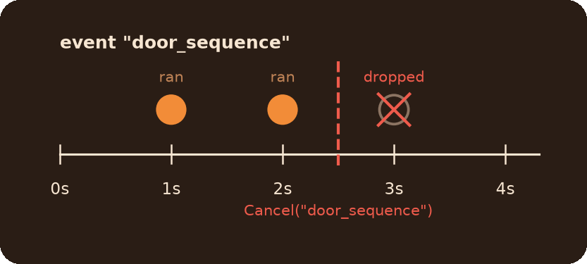
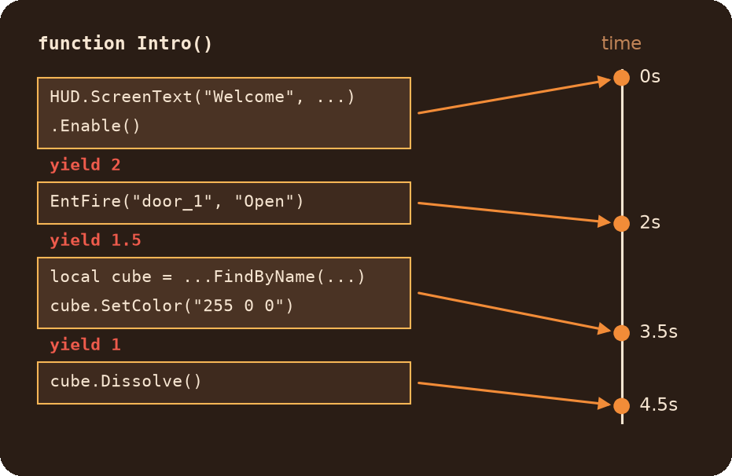

# ActionScheduler Module

Run code later, repeat it every few seconds, write step-by-step sequences with pauses, and cancel any of it at any moment. Everything goes through `ScheduleEvent`.

## Table of Contents

* [How it works](#how-it-works)
* [What do I need?](#what-do-i-need)
* [Recipes](#recipes)
	* [Do something later](#do-something-later)
	* [Repeat every N seconds, and stop it](#repeat-every-n-seconds-and-stop-it)
	* [Pass values to the action](#pass-values-to-the-action)
	* [Call a method of an object](#call-a-method-of-an-object)
	* [A sequence with pauses (yield)](#a-sequence-with-pauses-yield)
	* [Cancel a whole sequence](#cancel-a-whole-sequence)
	* [Cancel later, or only if it exists](#cancel-later-or-only-if-it-exists)
	* [Delayed entity changes and inputs](#delayed-entity-changes-and-inputs)
* [When an action throws an error](#when-an-action-throws-an-error)
* [Common mistakes](#common-mistakes)
* [Reference](#reference)
* [Advanced](#advanced)

## How it works

You schedule an **action** (a function, or a string of code) to run after a delay. Every action belongs to an **event**: just a name you pick, like `"door_sequence"`. The name has one job: you can cancel all the actions under it at once with `ScheduleEvent.Cancel("door_sequence")`.

* An event appears when you add the first action to it and disappears when its last action has run. There is nothing to create or clean up.
* The event `"global"` always exists and **can't be cancelled**. Use it only for things you never want to stop.
* Delays are in seconds, counted from the moment you call `Add`. The scheduler checks the actions every tick, so an action runs on the first tick at or after its time.



## What do I need?

| You need | Use |
|---|---|
| Run something once, after a delay | `ScheduleEvent.Add(event, action, delay)` |
| Run something every N seconds | `ScheduleEvent.AddInterval(event, action, interval)` |
| A short sequence with pauses written top to bottom | A function with `yield <seconds>`, added with `Add` |
| A long-running or endless sequence in single player | A function that re-adds itself with `Add`, its state in `args` (see the [warning](#a-sequence-with-pauses-yield)) |
| Stop everything under an event name | `ScheduleEvent.Cancel(event)` |
| Stop it, but no error if it's already gone | `ScheduleEvent.TryCancel(event)` |
| Check whether an event still has pending actions | `ScheduleEvent.IsValid(event)` |

## Recipes

### Do something later

```js
ScheduleEvent.Add("global", function() {
    printl("3 seconds later")
}, 3)

// A named function works the same. Pass it without (), the scheduler calls it
function OpenDoor() {
    EntFire("door", "Open")
}
ScheduleEvent.Add("doors", OpenDoor, 1.5)

// A string is run as code
ScheduleEvent.Add("doors", "EntFire(\"door\", \"Close\")", 5)
```

A delay of 0 doesn't run the action right away: it runs on a scheduler tick, after your current code has finished.

### Repeat every N seconds, and stop it

Give the interval its own event name, then cancel that name:

```js
ScheduleEvent.AddInterval("beeper", function() {
    GetPlayerEx().EmitSound("buttons/blip1.wav")
}, 0.5)

// Later, from anywhere, even from inside the action itself
ScheduleEvent.Cancel("beeper")
```

The fourth argument is the delay before the first run (0 by default: the first run is on the next scheduler tick):

```js
// First run in 2 seconds, then every second
ScheduleEvent.AddInterval("radar", ScanArea, 1, 2)
```

An interval keeps going until its event is cancelled, even if the action throws an error. An interval added to `"global"` can never be stopped.

### Pass values to the action

The fourth argument of `Add` (the fifth of `AddInterval`) is an **array** of arguments. The action gets them as its parameters:

```js
function Explode(ent, power) {
    printl(ent.GetName() + " explodes with power " + power)
}

ScheduleEvent.Add("boom", Explode, 2, [cube, 100])

// One argument is still an array
ScheduleEvent.Add("boom", function(ent) { ent.Kill() }, 3, [cube])
```

An `ArrayEx` or a `List` works too. A native array is kept as it is, so the action sees what the array holds when it runs: don't change it after passing it.

Another way is to bind values right into the function with `: (...)`. A function in VScript can't see the local variables around it unless you list them like this, and their values are copied at that moment:

```js
local cube = entLib.FindByName("cube_1")
ScheduleEvent.Add("boom", function() : (cube) {
    cube.Dissolve()
}, 2)
```

### Call a method of an object

By default `this` inside an action is the root table. To call a method of a class instance, pass the instance as the last argument (`scope`):

```js
class Turret {
    shots = 0
    function Fire() {
        this.shots++
        printl("Shot " + this.shots)
    }
}

local turret = Turret()
ScheduleEvent.AddInterval("turret_fire", turret.Fire, 0.3, 0, null, turret)
```

`Add` takes it in the same place: `ScheduleEvent.Add(event, action, delay, args, scope)`. Pass `null` for `args` if you have none.

### A sequence with pauses (yield)

A function with `yield` in it becomes a step-by-step sequence. `yield 2` pauses it for 2 seconds, then it continues from the same line, with all its local variables still there:

```js
function Intro() {
    HUD.ScreenText("Welcome", -1, 0.4).SetHoldTime(2).Enable()
    yield 2

    EntFire("door_1", "Open")
    yield 1.5

    local cube = entLib.FindByName("intro_cube")
    cube.SetColor("255 0 0")
    yield 1

    cube.Dissolve()
}

ScheduleEvent.Add("intro", Intro, 0)
```

What `yield` means:

| You write | What happens |
|---|---|
| `yield 2`, `yield 0.5` | Pause for that many seconds |
| `yield 0` (or less) | Pause for one frame |
| `yield` or `yield null` | **The sequence ends**, the rest of the function never runs |

`yield` only pauses: it is not a way to return a value.



> [!WARNING]
> **`yield` sequences break save/load.** Saving or loading the game while a sequence is paused on a `yield` crashes the game: the engine can't save a paused generator.
>
> Use `yield` for short sequences that are over in a few seconds, or in coop maps, which have no saving. For anything long-running or endless in single player, use a plain function that schedules its own next step with `Add` and passes its state through `args`.

The same idea without `yield`: each step is a separate action, and nothing stays paused between them:

```js
function PatrolStep(index) {
    local points = ["patrol_a", "patrol_b", "patrol_c"]
    printl("Going to " + points[index])
    ScheduleEvent.Add("patrol", PatrolStep, 2, [(index + 1) % points.len()])
}
ScheduleEvent.Add("patrol", PatrolStep, 0, [0])

// Stops like any other event
ScheduleEvent.Cancel("patrol")
```

### Cancel a whole sequence

Everything added under one name is cancelled together: plain actions, intervals and paused `yield` sequences. Pick a name per thing you may want to stop:

```js
function StartAlarm() {
    ScheduleEvent.AddInterval("alarm", function() { EntFire("alarm_light", "Toggle") }, 0.5)
    ScheduleEvent.Add("alarm", function() { EntFire("alarm_sound", "PlaySound") }, 0)
    ScheduleEvent.Add("alarm", function() { EntFire("blast_door", "Close") }, 10)
}

function StopAlarm() {
    ScheduleEvent.TryCancel("alarm")
}
```

The event name is usually a string, but any value that can be a table key works, e.g. an entity: `ScheduleEvent.Add(cube, ...)` gives every cube its own event.

### Cancel later, or only if it exists

```js
ScheduleEvent.Cancel("alarm", 5)   // cancel in 5 seconds
ScheduleEvent.TryCancel("alarm")   // no error if "alarm" doesn't exist
```

| | `Cancel` | `TryCancel` |
|---|---|---|
| The event exists | Cancels it | Cancels it, returns `true` |
| The event doesn't exist | **Throws an error** | Returns `false` |
| `"global"` | Throws an error | Throws an error |

With a delay, `Cancel` still throws right away if the event doesn't exist at the moment of the call. When the delay is over, the event is cancelled if it still exists.

### Delayed entity changes and inputs

Most `pcapEntity` setters take a delay and an event name as their last two arguments, and the library's `EntFireByHandle` takes an event name as its last argument. With an event name, the delayed change can be cancelled like any other action:

```js
cube.SetColor("255 0 0", 3, "cube_fx")
EntFireByHandle(door, "Open", "", 5, null, null, "cube_fx")

ScheduleEvent.Cancel("cube_fx") // neither happens
```

Without an event name, the setters schedule into `"global"` and `EntFireByHandle` uses the engine's own delay: neither can be cancelled. See the [IDT](../IDT/readme.md) and [Utils](../Utils/readme.md) readmes. Animations are scheduled the same way, under the `eventName` of their settings, see [Animations](../Animations/readme.md).

## When an action throws an error

The error doesn't stop the scheduler. It prints a `SCHEDULED EVENT` block to the console with the event name, the action, the error and the function's source info, plays a warning sound, and goes on: the other actions of the event and of all other events still run. An interval keeps repeating.

Console commands for checking what's scheduled:

* `PCore_schedule_list`: prints the names of all events that have pending actions.
* `PCore_schedule_clear`: cancels all events except `"global"`.

## Common mistakes

* **An interval in `"global"`.** It can never be stopped. Give it its own event name.
* **A bare `yield`.** It ends the sequence instead of pausing. Write `yield 0` for one frame.
* **A long `yield` loop in a single-player map.** A save or a load while it is paused crashes the game. Re-add a plain function with `Add` instead, see the [warning](#a-sequence-with-pauses-yield).
* **One argument without an array.** `Add("boom", Explode, 1, cube)` throws: write `[cube]`.
* **`MyFunc()` instead of `MyFunc`.** With `()` you pass what the function returned, not the function.
* **`Cancel` on an event that may be over.** An event disappears after its last action. Use `TryCancel` if you're not sure it's still there.
* **`this` in a method.** Without the `scope` argument, `this` inside the action is the root table, not your object.
* **One event name for unrelated things.** `Cancel` stops all of them. One name per thing you want to stop.

## Reference

| Function | What it does |
|---|---|
| `ScheduleEvent.Add(eventName, action, delay, args = null, scope = null)` | Runs `action` once after `delay` seconds |
| `ScheduleEvent.AddInterval(eventName, action, interval, initialDelay = 0, args = null, scope = null)` | Runs `action` every `interval` seconds (greater than 0), the first time after `initialDelay` |
| `ScheduleEvent.Cancel(eventName, delay = 0)` | Drops all pending actions of the event. Throws for `"global"` and for an event that doesn't exist |
| `ScheduleEvent.TryCancel(eventName, delay = 0)` | Like `Cancel`, but returns `false` instead of throwing if the event doesn't exist. Returns `null` with a delay |
| `ScheduleEvent.CancelAll()` | Cancels every event except `"global"` |
| `ScheduleEvent.IsValid(eventName)` | `true` if the event exists, i.e. it still has pending actions (`"global"` always exists) |

* `action`: a function, a function with `yield`, or a string of code.
* `args`: an `array`, `ArrayEx` or `List` of arguments for the action, or `null`.
* `scope`: the object used as `this` in the action. The root table by default.

Within one event, actions due at the same time run in the order they were added.

## Advanced

Most scripts never need these.

* `ScheduleEvent.GetEvent(eventName)`: the event's pending actions as a `List` of `ScheduleAction`, or `null`. It is the live queue, not a copy: don't change it.
* `ScheduleAction(scope, action, delay, args = null)`: one action, not scheduled yet. `delay` is counted from the moment it's created, `args` must be a native array or `null`.
* `ScheduleEvent.AddActions(eventName, actions, noSort = false)`: adds many prepared `ScheduleAction`s at once (an `array`, `ArrayEx` or `List`), faster than calling `Add` for each. `noSort = true` skips sorting when the event is new and the actions are already in time order.

  ```js
  local actions = []
  for(local i = 1; i <= 10; i++)
      actions.append(ScheduleAction(getroottable(), function(n) { printl(n) }, i * 0.1, [i]))
  ScheduleEvent.AddActions("countdown", actions, true)
  ```

* `ScheduleEvent.UNSAFE_ClearWithGlobal()`: cancels everything, `"global"` included. Read the caution below first.

> [!CAUTION]
> `UNSAFE_ClearWithGlobal()` also removes the library's own repeating jobs, which live in `"global"`: player death and respawn tracking (the player hooks), the entity cache cleanup and the `linked_portal_door` setup. They don't come back after it. The `"global"` actions of every other script are gone too.
