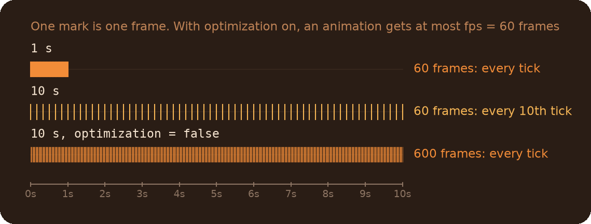

# Animations Module

Smooth changes of an entity's opacity, color, position or angles over time, with easing, delays, an action at the end and cancelling. You can also build animations for any other property.

## Table of Contents

* [Quick start](#quick-start)
* [What do I need?](#what-do-i-need)
* [Which entities](#which-entities)
* [Settings](#settings)
* [Recipes](#recipes)
* [Real-time animations](#real-time-animations)
* [Your own animations](#your-own-animations)
* [Common mistakes](#common-mistakes)
* [Reference](#reference)

## Quick start

```js
// Fade a door out over 2 seconds
animate.AlphaTransition("exit_door", 255, 0, 2)

// Move a platform up by 128 units in 3 seconds, slow at both ends, then print
local platform = entLib.FindByName("platform")
local from = platform.GetOrigin()
animate.PositionTransitionByTime(platform, from, from + Vector(0, 0, 128), 3, {
    ease = math.ease.InOutSine,
    output = function() { printl("Arrived") }
})
```

Every animation function returns its duration in seconds.

## What do I need?

| Animate | Use |
|---|---|
| Opacity | `animate.AlphaTransition(entities, startAlpha, endAlpha, time, settings)` |
| Color | `animate.ColorTransition(entities, startColor, endColor, time, settings)` |
| Position, in a given time | `animate.PositionTransitionByTime(entities, startPos, endPos, time, settings)` |
| Position, at a given speed | `animate.PositionTransitionBySpeed(entities, startPos, endPos, speed, settings)` |
| Angles | `animate.AnglesTransitionByTime(entities, startAngles, endAngles, time, settings)` |
| Anything else: scale, skin, a light's brightness | [your own animation](#your-own-animations) |
| Stop it halfway on a condition | the [real-time](#real-time-animations) versions, `animate.RT.*` |

* Alpha goes from 0 (invisible) to 255. It's only visible if the entity's `rendermode` isn't 0: `ent.SetKeyValue("rendermode", 1)`.
* Colors are strings (`"255 0 0"`) or Vectors (`Vector(255, 0, 0)`).
* Angles turn the shorter way on each axis: from 350 to 10 degrees is +20, not -340.
* Position is set with the engine's `SetAbsOrigin`, so the move is interpolated on the client.

## Which entities

The first argument can be:

* A targetname: `"door"`. With a `*` at the end, every matching entity: `"light_*"`.
* An entity: `CBaseEntity` or `pcapEntity`.
* An `array`, `ArrayEx` or `List` of entities.

All of them move together, with the same values.

## Settings

The last argument is an optional table. All keys are optional.

| Key | Default | Meaning |
|---|---|---|
| `ease` | linear | The easing function, usually one of [`math.ease.*`](../Math/readme.md#easing): `ease = math.ease.OutBounce` |
| `globalDelay` | 0 | Seconds to wait before the animation starts |
| `output` | none | A function or a code string that runs when the animation ends |
| `scope` | root table | `this` inside `output` |
| `eventName` | a unique name | The [scheduler event](../ActionScheduler/readme.md) the frames go to. Name it to cancel the animation |
| `optimization` | true | Limits long animations to `fps` frames in total, see below. With `false`, every animation updates every tick |
| `fps` | 60 | The frame limit used by `optimization`: frames for the **whole** animation, not per second |
| `frameInterval` | `FrameTime()` | Seconds between frames, before the `fps` limit |
| `filterCallback` | none | Real-time only: stops the animation, see [Real-time animations](#real-time-animations) |

**About `fps` and `optimization`.** Frames are applied at most once per tick, and every frame is a scheduled action. With `optimization` on (the default) an animation gets at most `fps` frames in total, 60 by default: a 1 second animation still updates every tick, a 10 second one every 10th tick instead of scheduling 600 frames. If you need an update every tick over a long animation, set `optimization = false`.



## Recipes

**Wait, then animate**

```js
animate.AlphaTransition(cube, 255, 0, 1, {globalDelay = 2})
```

**One after another.** The functions return their duration, so the next one waits for it:

```js
local t = animate.PositionTransitionByTime(lift, bottom, top, 3)
animate.ColorTransition(lift, "255 255 255", "0 255 0", 0.5, {globalDelay = t})
```

**Do something at the end**

```js
animate.AlphaTransition(wall, 255, 0, 1, {
    output = function() { wall.Kill() }
})

// A method of your object
animate.AlphaTransition(wall, 255, 0, 1, {output = this.OnFaded, scope = this})
```

**Cancel an animation.** Give it an event name, then cancel the event. The entity stays where the animation left it:

```js
animate.PositionTransitionByTime(lift, bottom, top, 5, {eventName = "lift_move"})

// later
ScheduleEvent.TryCancel("lift_move")
```

`TryCancel` doesn't throw if the animation has already ended. Several animations can share one event name, then one call stops all of them.

**Move at a constant speed**

```js
animate.PositionTransitionBySpeed(cart, start, end, 4)
```

`speed` is in units **per frame** (per `frameInterval`, about 1/60 of a second by default), not per second. 4 units per frame is roughly 240 units per second.

**Fade many entities at once**

```js
animate.AlphaTransition("lamp_*", 0, 255, 1.5)
```

## Real-time animations

`animate.RT.AlphaTransition`, `animate.RT.ColorTransition`, `animate.RT.PositionTransitionByTime`, `animate.RT.PositionTransitionBySpeed` and `animate.RT.AnglesTransitionByTime` take the same arguments. The difference: the normal versions compute and schedule all frames at once, the RT versions compute each frame when it plays. That lets `filterCallback` stop the animation:

```js
animate.RT.PositionTransitionByTime(crusher, top, bottom, 2, {
    // Stop as soon as the button is released
    filterCallback = function(animInfo, newValue, lastFrame, step, vars) {
        return !::buttonHeld
    }
})
```

* `filterCallback` runs before every frame. Returning `true` stops the animation, and `output` doesn't run.
* It gets 5 arguments and must accept all of them: the animation, the value of the coming frame, the number of the last frame, the number of this frame, and the internal values of the animation.
* In RT animations `fps` works differently: by default a frame is applied every `FrameTime()`. If you set `fps`, the whole animation gets about that many frames, evenly spread. `PositionTransitionBySpeed` ignores `fps` in both kinds.

## Your own animations

`macros.BuildAnimateFunction(name, setter)` makes an animation function for any property. The `setter(entity, value)` applies one frame's value, the library computes the values between the start and the end:

```js
animate.ScaleTransition <- macros.BuildAnimateFunction("scale", function(ent, value) {
    ent.SetModelScale(value)
})

// Used like the built-in ones, settings included
animate.ScaleTransition(cube, 1.0, 2.0, 0.5, {ease = math.ease.OutBack})
```

* The values must support `end - start` and multiplying by a number: numbers and Vectors do.
* For values that aren't simply between the start and the end (skins, strings), pass a third argument, `valueCalculator(step, lastStep, vars)`. It returns the value of a frame; `vars` holds `start`, `delta` (end minus start) and `easeFunc`:

```js
animate.SkinTransition <- macros.BuildAnimateFunction("skin",
    function(ent, skin) { ent.SetSkin(skin) },
    function(step, lastStep, vars) {
        return (vars.start + vars.delta * vars.easeFunc(step.tofloat() / lastStep)).tointeger()
    }
)
```

`macros.BuildRTAnimateFunction` builds the [real-time](#real-time-animations) kind, with the same arguments.

## Common mistakes

* **Alpha changes but nothing is visible.** The entity's `rendermode` is 0. Set it to something else before animating.
* **`time` of 0.** Every animation needs a duration above 0. A zero `time`, or a `PositionTransitionBySpeed` with the start equal to the end, gives the entity an invalid value.
* **Killing an entity in the middle of its animation.** The remaining frames try to set a value on a dead entity, and each one prints an error. Cancel the animation first (`ScheduleEvent.TryCancel(eventName)`), or kill it in `output`.
* **Two animations of the same property at once.** Both keep setting it until they end, each overwriting the other. Cancel the first one before starting the second.
* **`filterCallback` with fewer than 5 parameters.** It throws on every frame. Declare all five, even if you don't use them.

## Reference

| Function | |
|---|---|
| `animate.AlphaTransition(entities, startAlpha, endAlpha, time, settings = {})` | Opacity, 0..255 |
| `animate.ColorTransition(entities, startColor, endColor, time, settings = {})` | Color, a string or a Vector |
| `animate.PositionTransitionByTime(entities, startPos, endPos, time, settings = {})` | World position |
| `animate.PositionTransitionBySpeed(entities, startPos, endPos, speed, settings = {})` | World position, `speed` in units per frame, above 0 |
| `animate.AnglesTransitionByTime(entities, startAngles, endAngles, time, settings = {})` | Angles (pitch, yaw, roll), the shorter way |
| `animate.RT.*` | The same five, [real-time](#real-time-animations) |
| `macros.BuildAnimateFunction(name, setter, valueCalculator = null)` | Builds an animation function, see [above](#your-own-animations) |
| `macros.BuildRTAnimateFunction(name, setter, valueCalculator = null)` | The same, real-time |

All of them return the duration of the animation in seconds. `time` is in seconds.
