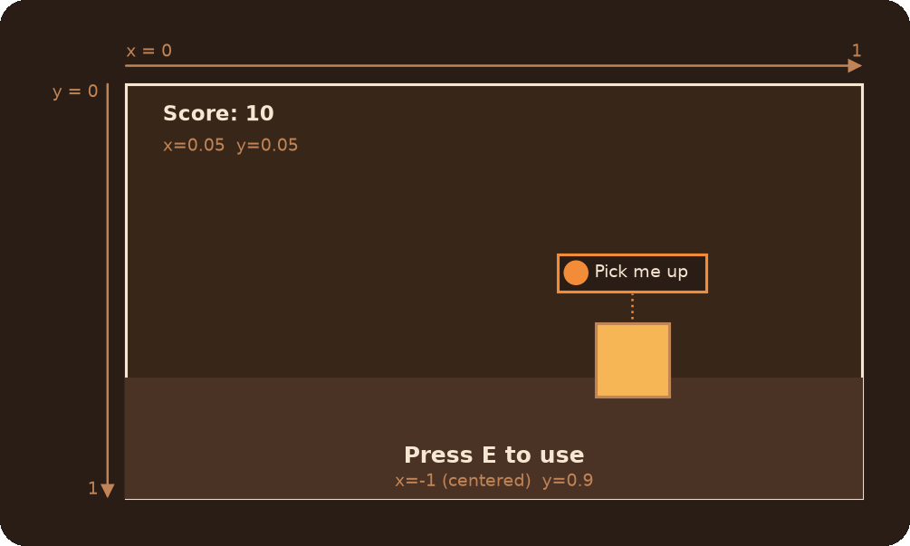

# HUD Module

On-screen text (`HUD.ScreenText`, the `game_text` entity) and instructor hints (`HUD.HintInstructor`, the `env_instructor_hint` entity). Both are built with chained calls and hold only their settings: the library takes care of the entities, so you can create them anywhere, even in a loop, without leaking entities.

## Table of Contents

* [What do I need?](#what-do-i-need)
* [`HUD.ScreenText`](#hudscreentext)
	* [`HUD.ScreenText(message, x, y)`](#hudscreentextmessage-x-y)
	* [`Enable(player)`](#enableplayer)
	* [`Disable(player)`](#disableplayer)
	* [Setters](#screentext-setters)
* [`HUD.HintInstructor`](#hudhintinstructor)
	* [`HUD.HintInstructor(message)`](#hudhintinstructormessage)
	* [`Enable(player)`](#enableplayer-1)
	* [`Disable()`](#disable)
	* [Setters](#hintinstructor-setters)
* [How the engine shows them](#how-the-engine-shows-them)
* [Common mistakes](#common-mistakes)

## What do I need?

| You need | Use |
|---|---|
| Text on the screen: a message, a counter, a subtitle | `HUD.ScreenText(text, x, y).Enable()` |
| An icon with a caption, on the HUD or above an entity | `HUD.HintInstructor(text).Enable()` |
| "Press E" with the player's real key | `HUD.HintInstructor(text).SetBind("+use").Enable()` |
| Show it to one coop player only | `Enable(player)` |
| Several texts at once | `ScreenText`s on different channels, `SetChannel(0..5)` |
| Update a text that's already shown | `SetText(newText).Enable()` on the same object |



## `HUD.ScreenText`

Text on the screen. Every method returns the ScreenText itself, so calls chain.

```js
HUD.ScreenText("Sequence Starting...", 0.5, 0.4).SetHoldTime(2).Enable()

// Create once, update and show again
ammoText <- HUD.ScreenText("", -1, 0.9).SetChannel(1).SetColor(Vector(255, 200, 0))
ammoText.SetText("Ammo: 7/10").Enable()
```

### `HUD.ScreenText(message, x, y)`

Creates a screen text. Nothing is shown until `Enable`.

* `message` (string): The text.
* `x` (number, optional): Horizontal position, from 0 (left) to 1 (right), or -1 to center (default -1).
* `y` (number, optional): Vertical position, from 0 (top) to 1 (bottom), or -1 to center (default -1).

### `Enable(player)`

Shows the text on its channel for the hold time, replacing whatever that channel showed.

* `player` (CBaseEntity|pcapEntity, optional): Show it to this player only, for coop. By default every player sees it.

### `Disable(player)`

Hides the text of its channel by showing an empty text there. Like any text, the empty one pauses instructor hints, for a few frames.

* `player` (CBaseEntity|pcapEntity, optional): Hide it for this player only.

### ScreenText setters

All of them only change the settings: the change is shown on the next `Enable`.

* `SetText(message)`: The text.
* `SetPos(x, y)`: The position, see the constructor.
* `SetChannel(channel)`: The channel, an integer from 0 to 5 (default 2). Texts on the same channel replace each other, texts on different channels are shown together. Channels 2 and 3 use the chapter title fonts.
* `SetColor(color)`: The text color, a Vector (`Vector(255, 0, 0)`) or a string (`"255 0 0"`). Default `"170 170 170"`.
* `SetColor2(color)`: The second color, used by some effects.
* `SetEffect(effect)`: The game_text `effect` keyvalue (Hammer lists 0 fade in/out, 1 credits, 2 scan out). With 2 the text is typed letter by letter, the newest letters in the second color.
* `SetFXTime(time)`: The game_text `fxtime` keyvalue, used by the effects.
* `SetFadeIn(time)`, `SetFadeOut(time)`: Fade times in seconds.
* `SetHoldTime(time)`: How long the text stays, in seconds (default 10).

## `HUD.HintInstructor`

An instructor hint: an icon with a caption, on the HUD or at an entity. Every method returns the HintInstructor itself, so calls chain.

```js
HUD.HintInstructor("Press E to use").SetBind("+use").AttachTo(button).Enable()

// Create once: each Enable replaces this hint's previous one, other hints stay
scannerHint <- HUD.HintInstructor("").SetHoldTime(0.1)
scannerHint.SetText("Hit World").Enable()
```

### `HUD.HintInstructor(message)`

Creates a hint, shown on the HUD by default. Nothing is shown until `Enable`.

* `message` (string): The caption.

### `Enable(player)`

Shows the hint. Different HintInstructors are shown at the same time; a new `Enable` of the same one replaces its previous hint.

* `player` (CBaseEntity|pcapEntity, optional): Show it to this player only, for coop. By default every player sees it. With `SetActivatorText`, everyone sees it and this player sees the activator text.

### `Disable()`

Hides the hint.

### HintInstructor setters

All of them only change the settings: the change is shown on the next `Enable`.

* `SetText(message)`: The caption.
* `SetActivatorText(message)`: The caption the player passed to `Enable(player)` sees, while everyone else sees `SetText`'s: "Press the button" for one, "Wait for your partner" for the other, in one hint. With it, `Enable(player)` shows the hint to everyone.
* `SetHoldTime(time)`: How long the hint is visible, in seconds (default 5). 0 keeps it until `Disable`.
* `ShowOnHud()`: Show the hint on the HUD (the default).
* `AttachTo(ent)`: Show the hint at an entity (CBaseEntity, pcapEntity or a targetname), following it. An unnamed entity gets a unique targetname, since the hint finds its target by name, on each `Enable`: if the target is gone by then, the hint has nothing to follow.
* `SetIcon(icon)`: The icon, both on screen and off screen (default `"icon_tip"`).
* `SetIconOnScreen(icon)`, `SetIconOffScreen(icon)`: The icon on screen, and at the screen edge while the target is off screen.
* `SetBind(bind)`: Show a key binding, e.g. `"+use"`. While it is set, the on-screen icon is the binding. `""` goes back to the icon.
* `SetColor(color)`: The caption color, a Vector or a string. Default white.
* `SetDistance(distance)`: The distance from the target at which the hint is visible, 0 for any distance.
* `SetEffects(sizePulsing, alphaPulsing, shaking)`: The `hint_pulseoption`, `hint_alphaoption` and `hint_shakeoption` keyvalues.

## How the engine shows them

These come from the engine, the library doesn't change them:

* **While any `game_text` is on screen, instructor hints are hidden**, and new ones wait. They come back once the text is gone. This includes the empty text of `ScreenText.Disable`.
* **The hold time of a hint only runs while it is visible.** A hint hidden by a text for 10 seconds stays 10 seconds longer.
* `game_text` has 6 channels, 0 to 5. Channels 2 and 3 use the chapter title fonts (`InGameChapterSubtitle`, `InGameChapterTitle`).
* A text longer than 511 characters is cut.

> [!WARNING]
> **Unique texts can crash the game.** Every distinct text a `ScreenText` or a `HintInstructor` shows stays in the engine's string pool until the map changes, and a full pool crashes the game (`CUtlRBTree overflow`). A new unique text every frame (a timer with hundredths, coordinates, raw floats) gets there in a long session. Change the text only when the value really changes, and round the numbers.

How the library manages the entities: `ScreenText` uses one `game_text` per channel, created on first use. `HintInstructor` creates an `env_instructor_hint` for each `Enable`/`Disable` and removes it right away: the hint lives on the client once shown.

## Common mistakes

* **A new `HintInstructor` for every update.** Each object is its own hint, so the old ones stay on screen until their hold time runs out. Create the hint once, then `SetText(...).Enable()` on it: that replaces its previous hint.
* **A hint that never shows up.** A `ScreenText` is on screen, and hints wait until it's gone. That includes the empty text of `ScreenText.Disable()`, for a few frames.
* **Texts that wipe each other out.** Two `ScreenText`s on the same channel replace each other, even from different scripts. Give each one its own channel.
* **Centering with 0.5.** To center a text on an axis, pass `-1` for it.
* **A text that changes every frame**, like a timer with hundredths. In a long session it crashes the game, see [the warning](#how-the-engine-shows-them). Call `SetText` only when the value actually changes.
