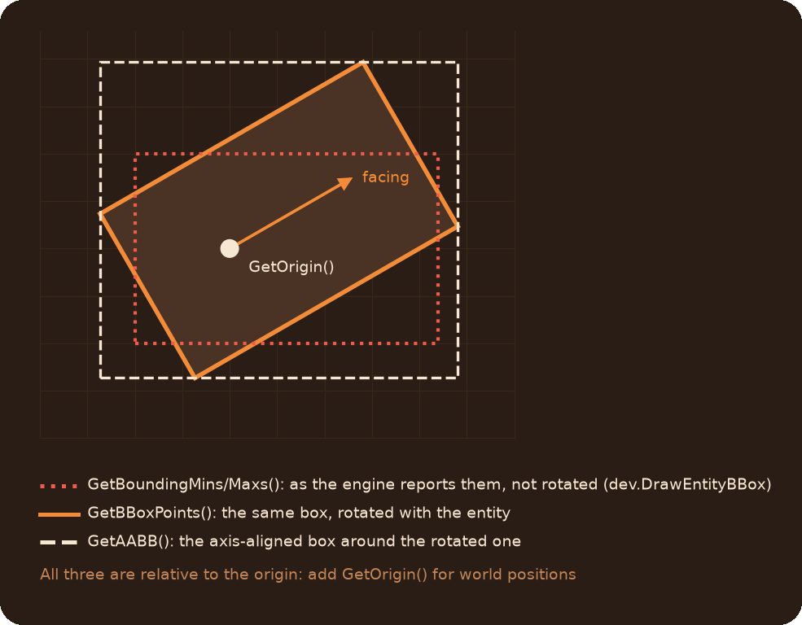
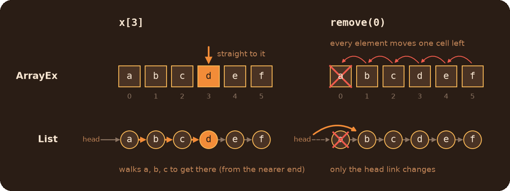

# IDT Module (Improved Data Types)

`pcapEntity`, a wrapper around entities with many more methods than the native handle, `entLib` to create, find and wrap them, and three containers: `ArrayEx`, `List` and `AVLTree`.

## Table of Contents

* [Entities](#entities)
	* [Getting a pcapEntity](#getting-a-pcapentity)
	* [Finding entities](#finding-entities)
	* [Creating entities](#creating-entities)
	* [What do I need?](#what-do-i-need)
	* [Recipes](#recipes)
	* [Common mistakes](#common-mistakes)
* [Containers](#containers)
	* [Which one?](#which-one)
	* [ArrayEx](#arrayex)
	* [List](#list)
	* [AVLTree](#avltree)
* [Reference](#reference)
	* [entLib](#entlib)
	* [pcapEntity](#pcapentity)
	* [ArrayEx methods](#arrayex-methods)
	* [List methods](#list-methods)
	* [AVLTree methods](#avltree-methods)

## Entities

### Getting a pcapEntity

A `pcapEntity` wraps a native entity handle. Everything the handle can do, the wrapper can do too (`GetOrigin`, `SetHealth`, `GetName`...), plus the methods [below](#pcapentity). Library functions take either one, and return `pcapEntity`.

```js
local ent = entLib.FromEntity(someHandle) // wrap any handle
local raw = ent.CBaseEntity               // the native handle back
```

One entity always has one wrapper: `FromEntity` on the same handle returns the same object, so data stored on it (`SetUserData`) is the same everywhere.

In an entity script, `self` is the native handle. `entLib.FromEntity(self)` gives its wrapper. Once a wrapper exists, the entity's script scope also has it as `selfEx`.

### Finding entities

`entLib.Find*` work like the native `Entities.Find*`, but take the arguments in a friendlier order and return `pcapEntity`. Each call returns **the next** match after `start_ent`, so all matches are found with a loop:

```js
// The first one
local door = entLib.FindByName("exit_door")

// All of them
for(local cube; cube = entLib.FindByClassname("prop_weighted_cube", cube);) {
    cube.SetColor("255 0 0")
}

// All buttons within 256 units of the player
local pos = GetPlayerEx().GetOrigin()
for(local btn; btn = entLib.FindByClassnameWithin("prop_floor_button", pos, 256, btn);) {
    printl(btn.GetName())
}
```

`FindByName` also takes the usual wildcards, e.g. `"door_*"`.

### Creating entities

```js
// Any entity, with its keyvalues
local text = entLib.CreateByClassname("game_text", {message = "Hi", holdtime = 3})

// A prop with a model
local cube = entLib.CreateProp("prop_physics", Vector(0, 0, 64), "models/props/metal_box.mdl")
```

Keyvalues are set with [`SetKeyValue`](#keyvalues-and-data), so numbers, strings, bools and Vectors all work.

### What do I need?

| I want to | Use |
|---|---|
| Remove an entity | `Kill()`, `Destroy()`, `Dissolve()` |
| Do something to it later | the `fireDelay` argument most setters have |
| Teleport it | `SetAbsOrigin(pos)`, `SetCenter(pos)` |
| Rotate it with a Vector | `SetAngles2(Vector(pitch, yaw, roll))` |
| Fade, recolor, hide it | `SetAlpha`, `SetColor`, `SetDrawEnabled` |
| Smoothly fade or move it | the [Animations module](../Animations/readme.md) |
| Store my own data on it | `SetUserData(name, value)` / `GetUserData(name)` |
| React to its outputs | `ConnectOutputEx(output, function)` |
| Block or intercept an input | `SetInputHook(input, function)` |
| Play a looped or quieter sound | `EmitSoundEx(sound, volume, looped)` |
| Attach it to another entity | `SetParent(parent)` |
| Know where a player looks | `EyePosition()`, `EyeForwardVector()` or [TracePlus](../TracePlus/readme.md) |
| Make traces ignore it | `SetTraceIgnore(true)` |
| Its rotated bounding box | `GetBBoxPoints()`, `GetAABB()` |

### Recipes

**Do it later.** Most setters take `fireDelay` in seconds, and an optional `eventName`. With an event name, everything scheduled under it can be cancelled at once (see [ActionScheduler](../ActionScheduler/readme.md)):

```js
door.SetColor("255 0 0", 2)    // in 2 seconds
door.Kill(5, "door_sequence")  // in 5 seconds, unless cancelled
ScheduleEvent.Cancel("door_sequence")
```

**Remove an entity**

```js
door.Kill()     // through the "Kill" input
cube.Destroy()  // the native Destroy, right now
wall.Dissolve() // the Portal fizzle effect
```

After any of these `ent.IsValid()` is false. For `Dissolve` that's right away, even though the effect takes a moment.

**Run your function on an output**

```js
button.ConnectOutputEx("OnPressed", function() {
    printl("pressed by " + activator)
})

// Only the first two presses, half a second after each
button.ConnectOutputEx("OnPressed", OnButton, 0.5, 2)
```

Inside the function `activator` and `caller` are set, like in any output. The function is called by its name through a `RunScriptCode` output, so pass an anonymous function or one defined in the root table: a named function anywhere else won't be found.

**Intercept an input.** The hook runs before the input. Return `true` to let it through, `false` to block it:

```js
door.SetInputHook("Open", function() {
    return ::powerOn // the door ignores Open while the power is off
})
```

**Store your own data on an entity**

```js
cube.SetUserData("owner", player)
local owner = cube.GetUserData("owner") // null if never set
```

**A sound with volume and looping**

```js
radio.EmitSoundEx("my_map.radio_song", 5, true) // volume 0..10, looped
radio.EmitSoundEx("my_map.radio_song", 2)       // still playing: only the volume changes
radio.StopSoundEx("my_map.radio_song")
```

**Teleport and rotate**

```js
ent.SetAbsOrigin(Vector(0, 0, 128))  // world position, works for parented entities too
ent.SetCenter(pos)                   // the bbox center goes to pos, not the origin
ent.SetAngles2(Vector(0, 90, 0))     // pitch, yaw, roll as one Vector
```

`SetAbsOrigin` teleports: clients don't interpolate, the entity just appears there. For a smooth engine-interpolated move, or for entities parented to an attachment, use `SetAbsOriginNative`.

**Work with the parent's children**

```js
foreach(child in platform.GetChildren().iter()) {
    child.SetDrawEnabled(false)
}
```

`GetChildren` returns direct children only, `GetAllChildrenRecursively` the whole tree. Both return a `List`, iterate it with `.iter()`.

**Which bounding box?** An entity has three, and they are easy to mix up:



```js
local corners = ent.GetBBoxPoints() // 8 corners: 0-3 the bottom, 4-7 the top
foreach(p in corners)
    dev.drawbox(ent.GetOrigin() + p) // relative to the origin, so add it

local box = ent.GetAABB()            // {min, max, halfSize}
```

### Common mistakes

* **`GetAlpha`, `GetColor`, `GetSkin`, `GetKeyValue` only know what was set through the library.** A color set in Hammer isn't read back: `GetColor()` returns `"255 255 255"` until you call `SetColor`. `GetKeyValue("model")`, `"health"` and `"targetname"` are the exception, they fall back to the real values.
* **`SetAlpha` does nothing visible** while the entity's `rendermode` is 0. Set it first: `ent.SetKeyValue("rendermode", 1)`.
* **User data names collide with keyvalues.** `SetUserData` names are case-insensitive and share one namespace with `SetKeyValue` keys and the library's own entries (`alpha`, `color`, `skin`, `eye`, `dissolved`, ...). Give your entries distinctive names.
* **`SetParent` may rename the parent.** The engine finds parents by name, so a parent without a name, or with a name shared by other entities, gets a unique one.
* **Using a wrapper after `Kill` or `Destroy`.** They clear `ent.CBaseEntity`, so any later method throws. Check `IsValid()` first.
* **`foreach` over a `List` throws.** `GetChildren()` and many other functions return a `List`: use `foreach(x in list.iter())`.
* **`SetContext` with a new value every frame.** Each distinct `name:value` stays in the engine's string pool until the map changes, and a full pool crashes the game, like [unique HUD texts](../HUD/readme.md#how-the-engine-shows-them). For fast-changing state use `SetUserData`.

## Containers

### Which one?

| Container | Good at | Bad at |
|---|---|---|
| `ArrayEx` | Almost everything. Fast indexing `arr[i]`, sorting with your own compare function | Removing from the front of a big array |
| `List` | Adding and removing at both ends: queues | Indexing: `list[i]` walks the list |
| `AVLTree` | Staying sorted while you insert and remove | Anything that isn't sorted data |



When in doubt, use `ArrayEx`.

All three have the same family of methods: `append`, `map`, `filter`, `reduce`, `search`, `join`, `unique`... The full lists are in the [reference](#arrayex-methods).

### ArrayEx

A native array with extra methods. Most of them return the array, so calls chain:

```js
local nums = ArrayEx(5, 3, 8, 1)
nums.append(4).sort()              // [1, 3, 4, 5, 8]

local big = nums.filter(function(idx, val, newArr) {
    return val > 3
})                                  // [4, 5, 8], a new ArrayEx
local doubled = nums.map(function(val, idx) {
    return val * 2
})                                  // a new ArrayEx
local sum = nums.reduce(function(acc, val) {
    return acc + val
}, 0)

printl(nums[0])                     // indexing works
foreach(idx, val in nums) {}        // so does foreach
```

**Mind the order of the callback arguments:** `map` and `apply` get `(value, index)`, `filter` gets `(index, value, newArray)`. All three must accept every argument they get.

Wrap an existing native array with `ArrayEx.FromArray(arr)`: it doesn't copy, both see the same elements. `nums.arr` is the native array inside.

### List

A doubly linked list. Same methods as `ArrayEx` plus `first()`, but it is iterated differently:

```js
local queue = List("a", "b")
queue.append("c")
local next = queue.remove(0) // "a"

foreach(val in queue.iter()) printl(val)  // iter() is required
```

`foreach(val in queue)` throws on purpose: use `iter()`. `pop()`, `top()` and `first()` throw on an empty list. `sort()` takes no compare function.

### AVLTree

A sorted collection: values stay in ascending order while you insert and remove them. Duplicates are allowed. The values must be comparable with `<`.

```js
local scores = AVLTree(50, 10, 30)
scores.insert(20)
scores.GetMin()       // 10
scores.GetMax()       // 50
scores[0]             // 10, index in ascending order
foreach(idx, val in scores) {} // ascending
scores.remove(30)
```

`search(value)` returns the tree node, not the value: use `.value` on it, or check it against `null`.

## Reference

### entLib

| Function | Returns |
|---|---|
| `entLib.FromEntity(handle)` | The `pcapEntity` of a handle. `null` for `null` or an invalid entity. A `pcapEntity` is returned as is |
| `entLib.CreateByClassname(classname, keyvalues = {})` | A new entity |
| `entLib.CreateProp(classname, origin, model, activity = 1, keyvalues = {})` | A new prop |
| `entLib.FindByClassname(classname, start_ent = null)` | The next match, or `null` |
| `entLib.FindByClassnameWithin(classname, origin, radius, start_ent = null)` | The next match within `radius`, or `null` |
| `entLib.FindByName(targetname, start_ent = null)` | The next match, or `null` |
| `entLib.FindByNameWithin(targetname, origin, radius, start_ent = null)` | The next match within `radius`, or `null` |
| `entLib.FindByModel(model, start_ent = null)` | The next match, or `null` |
| `entLib.FindByModelWithin(model, origin, radius, start_ent = null)` | The next match within `radius`, or `null` |
| `entLib.FindInSphere(origin, radius, start_ent = null)` | The next entity within `radius`, or `null` |

`start_ent` is the entity to continue the search after: the previous result in a loop. `radius` must be greater than 0.

### pcapEntity

Methods with `fireDelay = 0, eventName = "global"` at the end can be delayed. A delayed call in `"global"` can't be cancelled, pass your own `eventName` for that.

#### Removing

| Method | |
|---|---|
| `Kill(fireDelay, eventName)` | Removes the entity through the `Kill` input |
| `Destroy(fireDelay, eventName)` | Removes the entity right away |
| `Dissolve(fireDelay, eventName)` | Dissolves the entity (the fizzle effect) |
| `IsValid()` | `false` once the entity is gone, killed, destroyed or dissolved |

#### Position and rotation

| Method | |
|---|---|
| `SetAbsOrigin(pos)` | Teleports to a world position. Works for parented entities. Not interpolated |
| `SetAbsOriginNative(pos)` | The engine's own `SetAbsOrigin`: interpolated, handles attachment parents |
| `SetCenter(pos)` | Teleports so that the bbox center is at `pos`. Relative to the parent if parented |
| `SetAbsCenter(pos)` | Moves so that the bbox center is at the world position `pos`. Interpolated |
| `SetAngles2(angles)` | Sets the angles from a Vector (pitch, yaw, roll) |
| `GetLocalCoords()` | `{pos, ang}` relative to the parent, or the world ones without a parent |

#### Looks

| Method | |
|---|---|
| `SetAlpha(alpha, fireDelay, eventName)` / `GetAlpha()` | Opacity 0..255. Needs a `rendermode` other than 0 |
| `SetColor(color, fireDelay, eventName)` / `GetColor()` | `"255 0 0"` or `Vector(255, 0, 0)`. `GetColor` returns a string |
| `SetSkin(skin, fireDelay, eventName)` / `GetSkin()` | The skin number |
| `SetDrawEnabled(enabled, fireDelay, eventName)` / `IsDrawEnabled()` | Shows or hides the model. `IsDrawEnabled` is `null` until `SetDrawEnabled` is called |
| `SetModelScale(scale, fireDelay, eventName)` / `GetModelScale()` | The model scale. Also resets the body group to 0 |
| `SetAnimation(name, fireDelay, eventName)` | Plays a model animation |

`GetAlpha` is 255, `GetColor` `"255 255 255"`, `GetSkin` 0 and `GetModelScale` 1 until the matching setter is called.

#### Keyvalues and data

| Method | |
|---|---|
| `SetKeyValue(key, value, fireDelay, eventName)` | Sets a keyvalue: integer, float, bool (as 1/0), Vector or string |
| `GetKeyValue(key)` | The value set with `SetKeyValue`. For `model`, `health` and `targetname`, the real value if none was set. Otherwise `null` |
| `SetUserData(name, value)` / `GetUserData(name)` | Your own data on the entity. `null` if not set. Names are case-insensitive |
| `SetSpawnflags(flags, fireDelay, eventName)` / `GetSpawnflags()` | Spawnflags. `GetSpawnflags` is `null` if they weren't set through the library |
| `SetCollision(solidType, fireDelay, eventName)` | The solid type, a `SOLID_*` constant |
| `SetCollisionGroup(group, fireDelay, eventName)` | The collision group, a `COLLISION_GROUP_*` constant |
| `SetContext(name, value, fireDelay, eventName)` | Adds a response context `name:value`. Not for values that change every frame, see [mistakes](#common-mistakes) |

#### Names and hierarchy

| Method | |
|---|---|
| `SetName(name, fireDelay, eventName)` | Sets the targetname |
| `SetUniqueName(prefix = "pcapEnt", fireDelay, eventName)` | Sets a unique targetname starting with `prefix` |
| `GetNamePrefix()` | Everything up to and including the last `-`: `"door-"` for `"door-1"` |
| `GetNamePostfix()` | Everything from the first `-` on: `"-1"` for `"door-1"` |
| `SetParent(parent, fireDelay, eventName)` | Parents to an entity or a targetname. May rename the parent, see [mistakes](#common-mistakes) |
| `GetChildren()` | Direct children, a `List` of `pcapEntity` |
| `GetAllChildrenRecursively()` | All descendants, depth-first, a `List` of `pcapEntity` |

`GetNamePrefix` and `GetNamePostfix` return the whole name if it has no `-`.

#### Inputs and outputs

| Method | |
|---|---|
| `AddOutput(output, target, input, param = "", delay = 0, fires = -1)` | Connects an output to an input of another entity. `target` is a targetname or an entity. `fires = -1` is unlimited |
| `ConnectOutputEx(output, func, delay = 0, fires = -1)` | Calls your function on an output. A string is taken as a function name, then `delay` and `fires` don't apply |
| `SetInputHook(input, func)` | `func` runs before the input, returns `true` to let it through or `false` to block it |
| `Disable(fireDelay, eventName)` / `Enable(...)` | Fires the entity's `Disable`/`Enable` input and makes traces ignore it / hit it again |

#### Sounds

| Method | |
|---|---|
| `EmitSound(sound, fireDelay, eventName)` | Plays a sound on the entity |
| `EmitSoundEx(sound, volume = 10, looped = false, fireDelay, eventName)` | Plays a sound with a volume from 0 to 10, looped or not. Called again while playing, only changes the volume |
| `StopSoundEx(sound, fireDelay, eventName)` | Stops a sound started with `EmitSoundEx` |

#### Players

| Method | |
|---|---|
| `IsPlayer()` | `true` for a player |
| `EyePosition()` | Where the player's eyes are |
| `EyeAngles()` | Where the player looks, as angles |
| `EyeForwardVector()` | Where the player looks, as a unit vector |

For any other entity the eye methods return `GetCenter()`, `GetAngles()` and `GetForwardVector()`. For players they work once the library has picked the player up, which happens shortly after spawn. In code that runs on map load, wrap it in `RunWhenPlayerExists` (see [Utils](../Utils/readme.md)).

#### Bounds and traces

| Method | |
|---|---|
| `SetBBox(mins, maxs)` / `SetSize(mins, maxs)` | Sets the bounding box, local to the origin |
| `GetHalfSize()` | Half the size of the bounding box, not rotated |
| `GetBBoxPoints()` | The 8 corners of the bounding box rotated with the entity, relative to its origin |
| `GetBBoxFaces()` | The 6 faces of that box as 12 triangles: `{origin, vertices}`, relative to the origin |
| `GetAABB()` | `{min, max, halfSize}`: the axis-aligned box around the rotated one, relative to the origin |
| `IsSquareBbox()` | `true` if all sides of the bounding box are equal |
| `SetTraceIgnore(ignore, fireDelay, eventName)` / `IsTraceIgnored()` | Whether TracePlus bbox traces ignore the entity. `IsTraceIgnored` is `null` until set |

Add `GetOrigin()` to the relative points for world positions. Which box is which: [the picture in Recipes](#recipes).

#### Other

| Method | |
|---|---|
| `GetIndex()` | The entity index |
| `IsEqual(other)` | `true` if `other` (handle or wrapper) is the same entity |
| `GetPartnerInstance()` | For a `prop_portal` or `linked_portal_door`: its linked partner, or `null` |

**Native methods.** These go straight to the handle: `GetAngles`, `GetAngularVelocity`, `GetBoundingMaxs`, `GetBoundingMins`, `GetCenter`, `GetClassname`, `GetForwardVector`, `GetLeftVector`, `GetUpVector`, `GetHealth`, `GetMaxHealth`, `GetModelKeyValues`, `GetModelName`, `GetName`, `GetOrigin`, `GetScriptId`, `GetPartnername`, `GetPreTemplateName`, `GetTeam`, `GetVelocity`, `GetSoundDuration`, `GetScriptScope`, `ValidateScriptScope`, `entindex`, `IsSequenceFinished`, `SetForwardVector`, `SetHealth`, `SetMaxHealth`, `SetModel`, `SetOrigin`, `SetAngles`, `SetVelocity`, `SetAngularVelocity`, `SetTeam`, `SetOwner`, `ConnectOutput`, `DisconnectOutput`, `PrecacheSoundScript`, `SpawnEntity`, `__KeyValueFromInt`/`Float`/`String`/`Vector`.

`GetMoveParent`, `GetRootMoveParent`, `FirstMoveChild`, `NextMovePeer` and `GetOwner` return native handles, not `pcapEntity`.

### ArrayEx methods

Methods marked ↺ change the array and return it, for chaining.

| Method | |
|---|---|
| `ArrayEx(...)` | A new array of the given values |
| `ArrayEx.FromArray(arr)` | Wraps a native array without copying it |
| `ArrayEx.WithSize(n, fill = null)` | A new array of `n` copies of `fill` |
| `append(val)`, `push(val)` ↺ | Adds to the end |
| `insert(idx, val)` ↺ | Inserts at an index |
| `extend(other)` ↺ | Adds all elements of an `array` or `ArrayEx` |
| `pop()` | Removes and returns the last element |
| `remove(idx)` | Removes and returns the element at an index |
| `top()` | The last element |
| `get(idx, default = null)` | The element, or `default` past the end |
| `len()` | The number of elements |
| `clear()` ↺ | Removes everything |
| `resize(size, fill = null)` ↺ | Grows with `fill` or cuts |
| `reverse()` ↺ | Reverses in place |
| `sort(func = null)` ↺ | Sorts in place, with an optional compare function `func(a, b)` returning <0, 0 or >0 |
| `apply(func)` ↺ | Replaces each element with `func(value, index)` |
| `map(func)` | A new `ArrayEx` of `func(value, index)` |
| `filter(func)` | A new `ArrayEx` of the elements for which `func(index, value, newArray)` is true |
| `reduce(func, initial)` | Folds the array: `acc = func(acc, value)` for each element |
| `search(valOrFunc)` | The index of the first element equal to the value, or for which `func(value)` is true. `null` if none |
| `contains(val)` | `true` if an element `== val` |
| `unique()` | A new `ArrayEx` without duplicates, the first occurrence kept |
| `slice(start, end = null)` | A new `ArrayEx` of the elements from `start` up to `end` (not included) |
| `join(separator = "")` | The elements as one string |
| `totable()` | A table with the elements as keys (`null` elements skipped) |
| `tolist()` | A new `List` |
| `Clone()` | A shallow copy |

### List methods

Like `ArrayEx`, with these differences:

| Method | |
|---|---|
| `List(...)` | A new list of the given values |
| `List.FromArray(arr)` | A new list from a native array |
| `iter()` | Use it in `foreach`: `foreach(val in list.iter())` or `foreach(idx, val in list.iter())` |
| `first()`, `top()` | The first and the last element. Throw on an empty list |
| `pop()` | Removes and returns the last element. Throws on an empty list |
| `insert(idx, val)` | An index past the end appends |
| `sort()` | Ascending, no compare function |
| `extend(other)` | Adds the elements of any iterable: `array`, `ArrayEx` or `List` |
| `toarray()` | A new `ArrayEx` |

No `contains`, `push`, `Clone`, `tolist`. `list[i]` works, but walks the list from the nearest end.

### AVLTree methods

| Method | |
|---|---|
| `AVLTree(...)` | A new tree of the given values |
| `AVLTree.FromArray(arr)` | A new tree from an `array` or `ArrayEx` |
| `insert(value)` | Adds a value |
| `remove(value)` | Removes one occurrence of a value |
| `search(value)` | The node holding the value (`node.value`), or `null` |
| `GetMin()`, `GetMax()` | The smallest and the largest value. Throw on an empty tree |
| `len()` | The number of values |
| `tree[i]` | The `i`-th value in ascending order |
| `toarray()` | The values in ascending order, an `ArrayEx`. It's kept between calls: don't modify it, `Clone()` it first |
| `tolist()` | The values in ascending order, a new `List` |
| `printTree()` | Prints the tree structure to the console |
