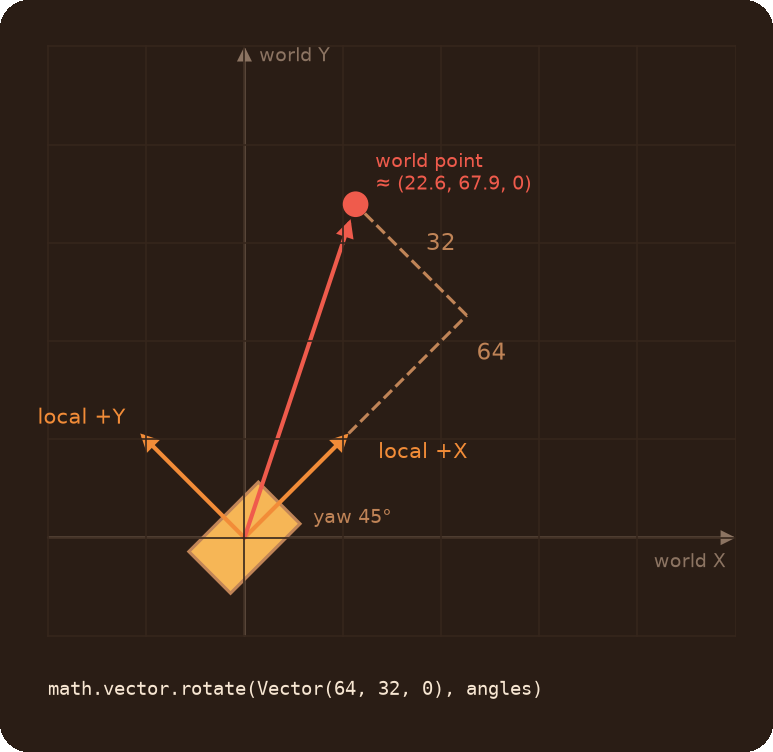
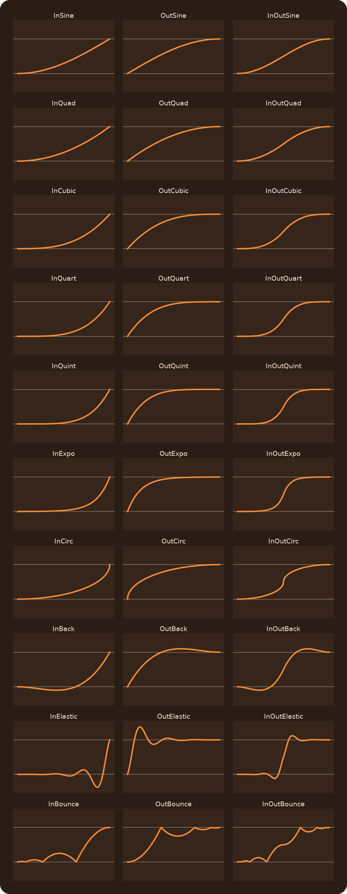

# Math Module

Number and vector helpers, interpolation, easing curves for animations, and quaternions and matrices for rotations. Everything lives in the `math` table.

## Table of Contents

* [What do I need?](#what-do-i-need)
* [Numbers](#numbers)
* [Vectors](#vectors)
* [Interpolation](#interpolation)
* [Easing](#easing)
* [Rotations: Quaternion and Matrix](#rotations-quaternion-and-matrix)
* [Common mistakes](#common-mistakes)

## What do I need?

| You need | Use |
|---|---|
| Keep a number in a range | `math.clamp(x, min, max)` |
| Round to 2 decimals | `math.round(x, 100)` |
| Convert a value from one range to another (0..1 to 0..255) | `math.RemapVal(x, 0, 1, 0, 255)` |
| The value between two others, `t` of the way | `math.lerp.number(a, b, t)`, `math.lerp.vector(a, b, t)` |
| A smooth start or stop instead of linear | `math.ease.InOutSine(t)` and the [other curves](#easing) |
| Rotate a direction or an offset by angles | `math.vector.rotate(vec, angles)` |
| Turn a world offset into an entity's local space | `math.vector.unrotate(vec, entity.GetAngles())` |
| Bounce a direction off a surface | `math.vector.reflect(dir, normal)` |
| A random point in a box | `math.vector.random(minVec, maxVec)` |
| Compare vectors without float noise | `math.vector.IsEqual(a, b)` |
| Blend between two orientations | `math.lerp.sVector(anglesA, anglesB, t)` |

## Numbers

| Function | Returns |
|---|---|
| `math.min(...)`, `math.max(...)` | The smallest / largest of any number of arguments |
| `math.clamp(x, min, max = 99999)` | `x` limited to `min..max` |
| `math.round(x, precision = 1)` | `x` rounded: `precision` 1 to a whole number, 10 to 1 decimal, 1000 to 3 decimals |
| `math.Sign(x)` | -1, 0 or 1 |
| `math.copysign(value, sign)` | `value` with the sign of `sign` |
| `math.RemapVal(x, A, B, C, D)` | `x` moved from the range `A..B` to `C..D`, not clamped. If `A == B`: `D` when `x >= B`, otherwise `C` |

```js
math.clamp(hp, 0, 100)
math.round(3.14159, 100)             // 3.14
math.RemapVal(distance, 0, 500, 255, 0) // 0 units -> 255, 500 units -> 0
```

## Vectors

All in `math.vector`, all return a new Vector.

| Function | Returns |
|---|---|
| `rotate(vec, angles)` | `vec` rotated by the Euler angles `angles` (pitch, yaw, roll, in degrees) |
| `unrotate(vec, angles)` | The opposite of `rotate`: `vec` brought back from that rotation |
| `reflect(dir, normal)` | `dir` bounced off a surface. `normal` must be a unit vector |
| `resize(vec, length)` | `vec` with the same direction and a new length. `vec` must not be zero |
| `random(min, max)` | A random Vector. With two Vectors each component is between theirs, with two numbers all components are between them |
| `clamp(vec, min = 0, max = 255)` | Each component limited to `min..max` (the defaults fit colors) |
| `round(vec, precision = 1000)` | Each component rounded, like `math.round` |
| `IsEqual(a, b, precision = 1000)` | `true` if the vectors are equal after rounding |
| `mul(a, b)` | Component by component: `Vector(a.x * b.x, a.y * b.y, a.z * b.z)` |
| `abs(vec)`, `sign(vec)` | The absolute values / signs of the components |
| `cmp(a, b)` | 1, -1 or 0, comparing the lengths |

```js
// A point 64 units in front of the entity and 32 to its left, whatever way it faces
local pos = ent.GetOrigin() + math.vector.rotate(Vector(64, 32, 0), ent.GetAngles())

// Where a world point is, in the entity's own axes
local localPos = math.vector.unrotate(point - ent.GetOrigin(), ent.GetAngles())
```

In the entity's own axes +X is forward, +Y is left and +Z is up.



## Interpolation

`t` goes from 0 (the start) to 1 (the end).

| Function | Returns |
|---|---|
| `math.lerp.number(a, b, t)` | The number `t` of the way from `a` to `b` |
| `math.lerp.vector(a, b, t)` | The same for Vectors |
| `math.lerp.color(a, b, t)` | The same for colors (`"255 0 0"` or Vectors). Returns a string `"r g b"`, whole numbers 0..255 |
| `math.lerp.sVector(a, b, t)` | Euler angles `t` of the way from one orientation to the other, along the shortest rotation |
| `math.lerp.SmoothStep(edge0, edge1, x)` | 0..1: where `x` is between the edges, smoothed at both ends. 0 below `edge0`, 1 above `edge1` |
| `math.lerp.FLerp(f1, f2, i1, i2, x)` | `x` mapped from `i1..i2` to `f1..f2`, not clamped. Like `RemapVal` with another argument order |

```js
local color = math.lerp.color("255 0 0", "0 0 255", 0.5)  // "127 0 127"
local mid = math.lerp.vector(doorA.GetOrigin(), doorB.GetOrigin(), 0.5)
```

Values outside 0..1 for `t` go past the ends in `number`, `vector` and `color` (colors are clamped to 0..255).

## Easing

Easing curves turn a linear `t` (0..1) into a curved one: slow at the start, slow at the end, overshooting, bouncing. Their main use is the `ease` setting of [animations](../Animations/readme.md#settings):

```js
animate.PositionTransitionByTime(lift, bottom, top, 3, {ease = math.ease.InOutQuad})
```

Pass the function itself, without `()`. You can also call them directly: `math.ease.OutBounce(0.5)`.

| Family | Feel | In | Out | In and out |
|---|---|---|---|---|
| Sine | Gentle | `InSine` | `OutSine` | `InOutSine` |
| Quad | A bit stronger | `InQuad` | `OutQuad` | `InOutQuad` |
| Cubic | Stronger | `InCubic` | `OutCubic` | `InOutCubic` |
| Quart | Strong | `InQuart` | `OutQuart` | `InOutQuart` |
| Quint | Very strong | `InQuint` | `OutQuint` | `InOutQuint` |
| Expo | Extreme | `InExpo` | `OutExpo` | `InOutExpo` |
| Circ | Sharp turn | `InCirc` | `OutCirc` | `InOutCirc` |
| Back | Pulls back past the start or end, then settles | `InBack` | `OutBack` | `InOutBack` |
| Elastic | Springs around the end | `InElastic` | `OutElastic` | `InOutElastic` |
| Bounce | Bounces like a dropped ball | `InBounce` | `OutBounce` | `InOutBounce` |

* **In** starts slow and speeds up, **Out** starts fast and slows down, **InOut** is slow at both ends.
* `Back` and `Elastic` go outside 0..1 for a moment: a position overshoots, an alpha or a color is clamped.
* Previews of every curve: [easings.net](https://easings.net). The formulas come from [gizma.com/easing](https://gizma.com/easing/).



## Rotations: Quaternion and Matrix

For most scripts `math.vector.rotate`/`unrotate` and `math.lerp.sVector` are enough. Use these when you rotate many vectors by the same rotation (create it once) or combine rotations.

```js
local q = math.Quaternion.fromEuler(ent.GetAngles())
foreach(offset in offsets)
    DebugDrawBox(ent.GetOrigin() + q.rotateVector(offset), Vector(-2, -2, -2), Vector(2, 2, 2), 255, 0, 0, 0, 5)

// Halfway between two orientations
local mid = math.Quaternion.fromEuler(a).slerp(math.Quaternion.fromEuler(b), 0.5).toVector()
```

**`math.Quaternion`**

| Method | |
|---|---|
| `math.Quaternion.fromEuler(angles)` | From Euler angles in degrees (pitch, yaw, roll) |
| `math.Quaternion.fromAxisAngle(axis, angle)` | A rotation by `angle` **radians** around the unit vector `axis` |
| `math.Quaternion(x, y, z, w)` | From raw components |
| `rotateVector(vec)`, `unrotateVector(vec)` | Rotates a Vector by the quaternion / back |
| `slerp(other, t)` | The rotation `t` of the way to `other` |
| `toVector()` | Back to Euler angles in degrees |
| `toAxisAngle()` | `{axis, angle}`, the angle in radians |
| `normalize()`, `inverse()`, `length()`, `dot(other)` | The usual quaternion operations, return new values |
| `IsEqual(other)` | `true` for the same rotation (`q` and `-q` count as equal) |
| `q1 * q2`, `q * number`, `q1 + q2`, `q1 - q2` | Operators |

**`math.Matrix`**, a 3x3 rotation matrix:

| Method | |
|---|---|
| `math.Matrix.fromEuler(angles)` | From Euler angles in degrees |
| `math.Matrix()` | The identity matrix. Or pass the 9 components row by row |
| `rotateVector(vec)`, `unrotateVector(vec)` | Rotates a Vector / back |
| `transpose()`, `inverse()`, `determinant()` | The usual matrix operations. `inverse` throws for a matrix with determinant 0 |
| `scale(factor)` | Every component multiplied by `factor` |
| `rotateX(angle)` | This matrix rotated around X by `angle` **radians** |
| `IsEqual(other)` | `true` if every component is equal within 0.0001 |
| `m1 * m2`, `m1 + m2`, `m1 - m2` | Operators |

## Common mistakes

* **Integer division.** `1 / 2` is `0` in Squirrel. `math.lerp.number(0, 10, 1 / 2)` gives 0: write `0.5`, or `.tofloat()` one side.
* **Degrees and radians.** Euler angles everywhere are degrees. Only `Quaternion.fromAxisAngle`, `toAxisAngle` and `Matrix.rotateX` use radians: multiply degrees by `PI / 180`.
* **`ease = math.ease.InSine()`.** That calls it. The setting needs the function: `ease = math.ease.InSine`.
* **Comparing vectors with `==`.** Two vectors that differ by float noise aren't `==`. Use `math.vector.IsEqual`.
* **`reflect` with a non-unit normal.** The result gets scaled. Normals from `trace.GetImpactNormal()` are already unit vectors.
