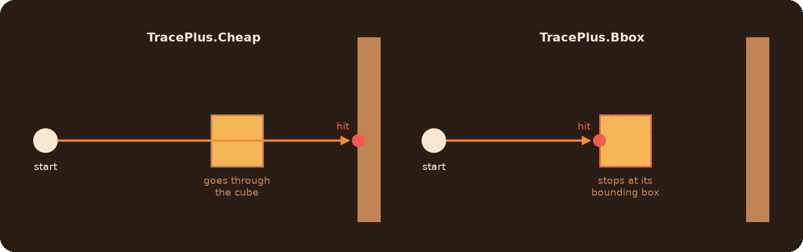
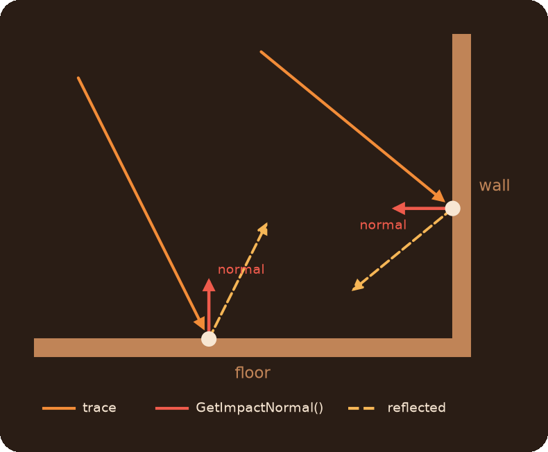
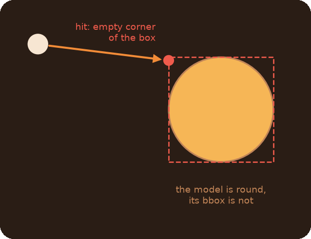
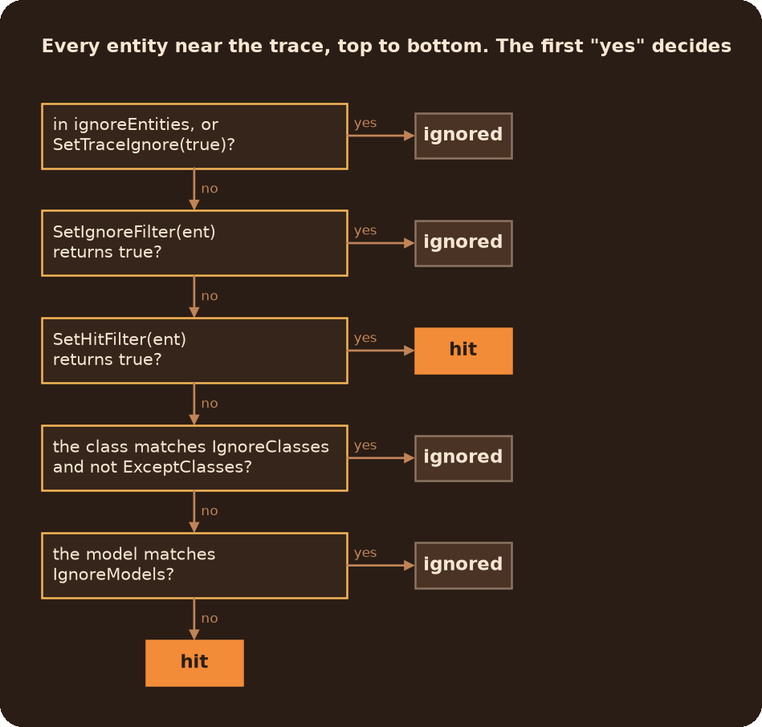
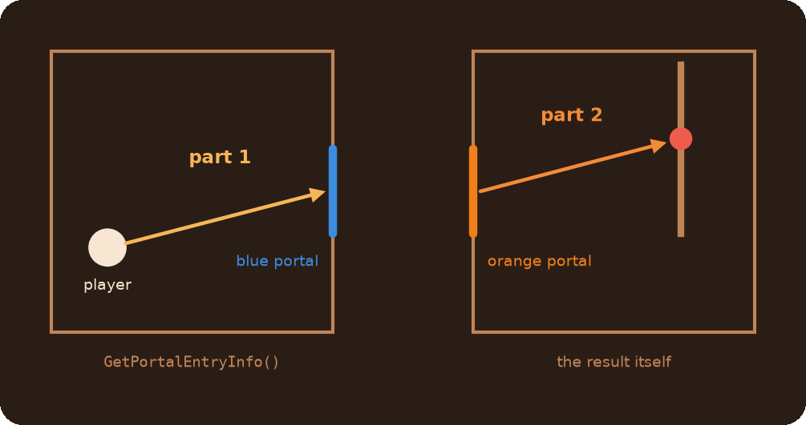

# TracePlus Module

Traces that hit entities, not only world geometry, and go through portals. Every trace returns a result object you ask what was hit, where, and at what angle.

## Table of Contents

* [Which trace do I need?](#which-trace-do-i-need)
* [Quick start](#quick-start)
* [Reading the result](#reading-the-result)
* [What a bbox trace hits](#what-a-bbox-trace-hits)
* [Choosing what to hit: recipes](#choosing-what-to-hit-recipes)
	* [How the rules combine](#how-the-rules-combine)
	* [Common mistakes](#common-mistakes)
* [Tracing through portals](#tracing-through-portals)
* [Reference](#reference)
	* [Traces](#traces)
	* [Result methods](#result-methods)
	* [`TracePlus.Settings` methods](#traceplussettings-methods)
	* [Other](#other)

## Which trace do I need?

| You need | Use |
|---|---|
| Where a line hits the world, as fast as possible | `TracePlus.Cheap(start, end)` |
| What entity a line hits: cubes, doors, buttons, players | `TracePlus.Bbox(start, end)` |
| The same, but continuing through portals | `TracePlus.PortalCheap` / `TracePlus.PortalBbox` |
| A trace from where a player is looking | `TracePlus.FromEyes.Cheap` / `.Bbox` / `.PortalCheap` / `.PortalBbox` |

`Cheap` is a plain `TraceLine`: it doesn't see entities at all. `Bbox` checks entity bounding boxes along the line and costs more. Use `Cheap` whenever you don't need the entity.




## Quick start

```js
// What is the player looking at?
local trace = TracePlus.FromEyes.Bbox(3000, GetPlayerEx())

if(trace.DidHitWorld()) {
    printl("A wall at " + trace.GetHitPos())
}
else if(trace.GetEntity()) {
    printl("An entity: " + trace.GetEntity().GetClassname())
}
```

The `FromEyes` traces take the distance first, then the player. The player itself is never hit by them.

## Reading the result

Every trace returns a result object with the same methods, so you can switch between `Cheap` and `Bbox` without changing the code that reads it:

```js
local trace = TracePlus.Bbox(start, end)

trace.DidHit()          // hit anything at all?
trace.DidHitWorld()     // hit world geometry, not an entity?
trace.GetEntity()       // the hit entity (pcapEntity), or null
trace.GetHitPos()       // where it stopped: the hit point, or `end` if nothing was hit
trace.GetImpactNormal() // the surface normal at the hit point
trace.GetFraction()     // 0..1, how far along the line it got
```

`Cheap` traces always return `null` from `GetEntity()`. The full list is in the [reference](#result-methods).

**The surface normal.** `GetImpactNormal()` is a unit vector that sticks straight out of the hit surface, toward the side the trace came from. A trace hitting a floor gets `Vector(0, 0, 1)`, a wall facing +X gets `Vector(1, 0, 0)`. For an entity it is the normal of the hit face of its bounding box. Typical uses: bounce a direction off the surface with `math.vector.reflect(trace.GetDir(), normal)`, or place and rotate something flat on the hit point.

```js
local trace = TracePlus.FromEyes.Bbox(3000, GetPlayerEx())
local normal = trace.GetImpactNormal()

// A prop on whatever the player looks at, facing out of the surface
local prop = entLib.CreateProp("prop_dynamic", trace.GetHitPos() + normal, "models/props/metal_box.mdl")
prop.SetForwardVector(normal)
```

It is computed on the first call and costs a bit more for world hits than for entities, so don't call it when you don't need it.




## What a bbox trace hits

* **Bounding boxes, not model shapes.** A `Bbox` trace hits the box around an entity (rotated with it), not its actual mesh. A trace can hit the empty corner of a box around a round model.
  

* **Not everything.** By default it ignores triggers, `info_`/`logic_`/`env_`/`point_` entities, lights, portals and other entities you normally don't want to hit. Add or remove classes with [`TracePlus.Settings`](#choosing-what-to-hit-recipes).
* **Entities marked with `SetTraceIgnore(true)` are skipped by every trace.** `ent.Disable()` does that too, `ent.Enable()` undoes it.
* **A trace that starts inside a box goes through that entity.** Cubes, turrets and `prop_physics` are the exception: they are hit right at the start.
* **Moving and turning entities are fine.** The library notices that by itself. If you change an entity's size or model through the native methods, call `TracePlus.InvalidateEntity(ent)`. `pcapEntity.SetBBox` and `SetSize` already do it.

<details>
<summary>The default ignored classes</summary>

`viewmodel`, `weapon_`, `beam`, `light`, `trigger_`, `phys_`, `env_`, `point_`, `info_`, `vgui_`, `logic_`, `clone`, `prop_portal`, `portal_base2D`, `func_clip`, `func_instance`, `func_portal_detector`, `func_noportal_volume`, `func_portal_bumper`, `func_areaportalwindow`, `path_track`, `npc_bullseye`, `move_rope`, `keyframe_rope`, `worldspawn`, `soundent`, `player_manager`, `bodyque`, `ai_network`, `generic_actor`

Each one matches every classname that contains it: `trigger_` covers `trigger_once`, `trigger_multiple` and so on.

</details>

## Choosing what to hit: recipes

There are two tools:

* The `ignoreEntities` argument: specific entities to skip in **this** trace.
* `TracePlus.Settings()`: rules by classname, model or your own function. Create it once, keep it in a variable and pass it to as many traces as you like.

Settings go into the **fourth** argument. If you have nothing to ignore, pass `null` as the third:

```js
TracePlus.Bbox(start, end, null, settings)
TracePlus.FromEyes.Bbox(3000, player, null, settings)
```

**Skip one entity, or a few**

```js
TracePlus.Bbox(start, end, cube)
TracePlus.Bbox(start, end, [cube, button, GetPlayerEx()])
```

`ignoreEntities` also takes an `ArrayEx` or a `List`.

**Make an entity invisible to all traces**

```js
glassWall.SetTraceIgnore(true)
```

**Don't hit players**

```js
noPlayers <- TracePlus.Settings().IgnoreClasses("player")
```

**Hit something the defaults ignore**, e.g. triggers. `ExceptClasses` punches a hole in the ignored classes, the other defaults stay:

```js
withTriggers <- TracePlus.Settings().ExceptClasses("trigger_multiple", "trigger_once")
```

**Hit only cubes**, nothing but the world and the listed classes:

```js
onlyCubes <- TracePlus.Settings()
    .IgnoreAllClasses()
    .ExceptClasses("prop_weighted_cube", "prop_monster_box")
```

**Ignore by model**

```js
noPipes <- TracePlus.Settings().IgnoreModels("models/props_pipes/")
```

**Ignore by name, or by any other condition.** The function gets a `pcapEntity` and returns `true` to ignore it:

```js
noGhosts <- TracePlus.Settings().SetIgnoreFilter(function(ent) {
    return ent.GetName().find("ghost_") == 0
})
```

**Hit by a condition, even if the classes or models say ignore.** Return `true` to hit the entity, `false` to leave it to the other rules:

```js
hitMarked <- TracePlus.Settings().SetHitFilter(function(ent) {
    return ent.GetUserData("hittable") == true
})
```

A hit filter makes traces slower: ignored classes can no longer be skipped early.

**Combine them.** Every method returns the settings, so calls chain:

```js
gunSettings <- TracePlus.Settings()
    .IgnoreClasses("player", "npc_portal_turret_floor")
    .ExceptClasses("trigger_multiple")
    .IgnoreModels("models/props/glass")
```

**Change the rules for every trace that gets no settings**

```js
TracePlus.defaultSettings.IgnoreClasses("player")
```

This affects every `Bbox` trace in the map that is called without settings, including other scripts.

**A variant of the defaults**, without changing them:

```js
local mine = TracePlus.defaultSettings.Clone().IgnoreModels("models/props/")
```

### How the rules combine



So `SetIgnoreFilter` beats everything else in the settings, `SetHitFilter` beats the classes and models, and `ExceptClasses` only works against `IgnoreClasses`.

A mask matches every name that **contains** it: `"cube"` matches `prop_weighted_cube`. A `*` at the ends of a mask is dropped (`"prop_*"` is the same as `"prop_"`), a `*` in the middle is an error. `"*"` alone ignores every class, like `IgnoreAllClasses()`.

### Common mistakes

* **`TracePlus.Settings.IgnoreClasses(...)` without `()`.** `Settings` is a class, create it first: `TracePlus.Settings().IgnoreClasses(...)`.
* **Settings as the third argument.** The third one is `ignoreEntities`, settings go fourth: `TracePlus.Bbox(start, end, null, settings)`.
* **`ClearIgnoredClasses()` to hit one ignored class.** It removes all defaults, and the trace starts hitting triggers, portals, `info_` entities and the rest. Use `ExceptClasses` for that.
* **New settings for every trace.** It works, but each `Settings` remembers its verdicts per classname. Create it once, outside the function that traces.

## Tracing through portals

`PortalCheap` and `PortalBbox` work like `Cheap` and `Bbox`. When the trace hits a portal that has a partner, it continues from the partner, up to `MAX_PORTAL_CAST_DEPTH` traces in total (4 by default, a global you can change).

The result is the **last** part of the path. The parts before it are kept too:




```js
local trace = TracePlus.FromEyes.PortalBbox(5000, GetPlayerEx())

// The whole path, first part first. It's a List, so iterate it with iter()
foreach(part in trace.GetAggregatedPortalEntryInfo().iter())
    DebugDrawLine(part.GetStartPos(), part.GetHitPos(), 255, 120, 0, false, 1)

// The part right before the last portal, or null if no portal was passed
local beforePortal = trace.GetPortalEntryInfo()
```

**What works by itself:**

* Players' portals (`prop_portal`). The library tracks which portals the engine has linked, including portals that were fizzled or switched with `SetActivatedState`: only a linked portal is traced through.
* `linked_portal_door`. The size comes from the door's `width` and `height`. A closed door (the `Close` input) and its partner are not traced through. Doors spawned later are picked up within 5 seconds.

**`prop_portal` placed in Hammer with its own `LinkageGroupID`.** The library sets up the pair ids `0` to `N-1` for the `N` players that joined. For a pair with another id, call this once after the map has loaded:

```js
InitPortalPair(5) // the LinkageGroupID of the pair
```

**Another size for a `linked_portal_door`.** Set its `model` keyvalue to the half width and half height, e.g. `64 32` for a 128x64 door. It takes priority over `width` and `height`.

Don't call `SetTraceIgnore` on a `prop_portal` yourself: the library sets it every time the pair changes, so your value gets overwritten.

## Reference

### Traces

| Function | Returns |
|---|---|
| `TracePlus.Cheap(start, end)` | `TraceResult` |
| `TracePlus.Bbox(start, end, ignoreEntities = null, settings = null)` | `BboxTraceResult` |
| `TracePlus.PortalCheap(start, end)` | `TraceResult` |
| `TracePlus.PortalBbox(start, end, ignoreEntities = null, settings = null)` | `BboxTraceResult` |
| `TracePlus.FromEyes.Cheap(distance, player)` | `TraceResult` |
| `TracePlus.FromEyes.Bbox(distance, player, ignoreEntities = null, settings = null)` | `BboxTraceResult` |
| `TracePlus.FromEyes.PortalCheap(distance, player)` | `TraceResult` |
| `TracePlus.FromEyes.PortalBbox(distance, player, ignoreEntities = null, settings = null)` | `BboxTraceResult` |

* `start`, `end` (Vector): world positions.
* `ignoreEntities`: one entity (`CBaseEntity` or `pcapEntity`), or an `array`, `ArrayEx` or `List` of them. Invalid entities in it are skipped.
* `settings` (`TracePlus.Settings`): `TracePlus.defaultSettings` if not given.
* `distance` (number): how far from the eyes, in units.
* `player` (`CBaseEntity` or `pcapEntity`): the player to trace from, always ignored by the trace.

A `Bbox` trace that starts outside the map stops right at its start: `GetHitPos()` is the start position, `GetFraction()` is 0.

### Result methods

| Method | Returns |
|---|---|
| `DidHit()` | `true` if the trace hit anything |
| `DidHitWorld()` | `true` if it hit world geometry and not an entity |
| `GetEntity()` | The hit entity (`pcapEntity`), or `null` for world hits, misses, `Cheap` traces and entities that no longer exist |
| `GetEntityClassname()` | The classname of the hit entity, or `null` |
| `GetHitPos()` | The hit point, or the end position if nothing was hit |
| `GetStartPos()`, `GetEndPos()` | The positions this trace was made with. For a portal trace: the ones of its last part |
| `GetFraction()` | 0 to 1, the part of the line before the hit |
| `GetDir()` | The unit direction of the trace |
| `GetImpactNormal()` | The unit normal of the hit surface. Computed on the first call |
| `GetPortalEntryInfo()` | The previous part of a portal trace, or `null` |
| `GetAggregatedPortalEntryInfo()` | All parts of a portal trace as a `List`, the first one first, this one last |
| `GetTraceSettings()` | The settings the trace used (`null` for `Cheap`) |
| `GetIngoreEntities()` | `Bbox` only: the `ignoreEntities` value the trace got |

### `TracePlus.Settings` methods

All of them, except the getters, return the settings themselves, so calls chain. The mask methods take any number of strings, arrays and `ArrayEx` of strings.

| Method | What it does |
|---|---|
| `TracePlus.Settings()` | New settings with the default ignored classes |
| `IgnoreClasses(...)` | Adds classname masks to ignore |
| `ExceptClasses(...)` | Adds classname masks that are hit even if `IgnoreClasses` matches them |
| `IgnoreAllClasses()` | Ignores every class, only `ExceptClasses` get through |
| `IgnoreModels(...)` | Adds model name masks to ignore |
| `SetIgnoreFilter(func)` | `func(ent)` returning `true` ignores the entity. `null` removes the filter |
| `SetHitFilter(func)` | `func(ent)` returning `true` hits the entity despite the classes and models. `null` removes the filter |
| `ClearIgnoredClasses()` | Removes all ignored classes, **the defaults too** |
| `ClearExceptedClasses()` | Removes all excepted classes |
| `ClearIgnoredModels()` | Removes all ignored models |
| `GetIgnoredClasses()`, `GetExceptedClasses()`, `GetIgnoredModels()` | A copy of the list (`ArrayEx`). Changing it doesn't change the settings |
| `GetIgnoreFilter()`, `GetHitFilter()` | The filter function, or `null` |
| `Clone()` | A copy of the settings. The lists are copied, the filter functions are shared |

### Other

* `TracePlus.defaultSettings`: the settings of every bbox trace called without settings. Changing it changes them for all such traces.
* `TracePlus.InvalidateEntity(ent)`: makes bbox traces re-read the entity's size and model. Needed after a native `SetSize` or `SetModel`.
* `MAX_PORTAL_CAST_DEPTH`: the maximum number of parts of a portal trace, 4 by default.
* `InitPortalPair(id)`: makes the `prop_portal` pair with this `LinkageGroupID` traceable through. See [Tracing through portals](#tracing-through-portals).
