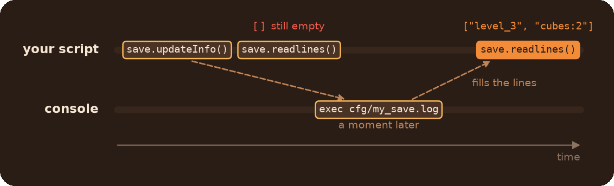

# Utils Module

Everyday helpers: debug drawing and logging, players and player events, saving text to a file, fixed engine functions, console commands, constants and the `macros` grab bag.

## Table of Contents

* [What do I need?](#what-do-i-need)
* [Debugging](#debugging)
	* [Logging](#logging)
	* [Drawing](#drawing)
	* [Console commands](#console-commands)
* [Players](#players)
	* [Player events](#player-events)
* [Files](#files)
* [Fixed engine functions](#fixed-engine-functions)
* [Constants](#constants)
* [Portals](#portals)
* [macros](#macros)
	* [Tables](#tables)
	* [Strings and vectors](#strings-and-vectors)
	* [Ranges](#ranges)
	* [Comparing and copying](#comparing-and-copying)
	* [Geometry checks](#geometry-checks)
	* [Sounds and console](#sounds-and-console)
	* [Custom animations](#custom-animations)

## What do I need?

| You need | Use |
|---|---|
| Print a message with values in it | `dev.info("hp: {}", hp)`, `macros.fprint(...)` |
| A warning or error that shows where it came from | `dev.warning(...)`, `dev.error(...)` |
| See a point or a box in the world | `dev.drawbox(pos)`, `dev.DrawEntityBBox(ent, color, time)` |
| The player (as a `pcapEntity`) | `GetPlayerEx()` |
| All players in coop | `GetPlayers()` |
| Run code once the player has spawned | `RunWhenPlayerExists(func)` |
| React to a player joining, dying, respawning, leaving | `AddPlayerJoinHook`, `AddPlayerDeathHook`, ... |
| Keep text between game sessions | `File("name")` |
| An input that can be cancelled before it fires | `EntFireByHandle(ent, "Open", "", 2, null, null, "myEvent")` |
| A unique targetname | `UniqueString("prefix")` |
| A value from a table, with a default | `macros.GetFromTable(table, key, default)` |
| `"1 2 3"` to `Vector(1, 2, 3)` and back | `macros.StrToVec`, `macros.VecToStr` |
| Compare two values of any type | `macros.IsEqual(a, b)` |
| Copy nested tables and arrays | `macros.DeepCopy(container)` |
| Your own animation (skin, scale, anything) | `macros.BuildAnimateFunction` |
| Collision groups and solid types by name | `COLLISION_GROUP_DEBRIS`, `SOLID_NONE`, ... |

## Debugging

### Logging

```js
dev.info("Cube {} spawned at {}", cube.GetName(), cube.GetOrigin())
dev.warning("No button named {}", name)
dev.error("Something broke")

// Same formatting, but always printed, with no prefix
macros.fprint("{} + {} = {}", 2, 2, 4)
```

* All `dev.*` functions do nothing while `developer` is 0. `macros.fprint` always prints.
* Each `{}` is replaced with the next argument. The number of `{}` must match the number of arguments, otherwise it throws.
* `dev.warning` and `dev.error` start the message with the name and line of the function that called them. `dev.error` also plays a warning sound.
* What gets printed depends on `::LibLogger`. It is `LoggerLevels.Info` by default, so `dev.debug` is **hidden** until you lower it:

```js
::LibLogger <- LoggerLevels.Debug
```

| Level | Prints |
|---|---|
| `LoggerLevels.Debug` | `debug`, `info`, `warning`, `error` |
| `LoggerLevels.Info` (default) | `info`, `warning`, `error` |
| `LoggerLevels.Warning` | `warning`, `error` |
| `LoggerLevels.Error` | `error` |
| `LoggerLevels.Off` | nothing |

`LoggerLevels.Trace` additionally shows the library's own internal messages.

### Drawing

These also do nothing while `developer` is 0. `color` is a Vector of 0..255 components, `time` is in seconds.

| Function | Draws |
|---|---|
| `dev.drawbox(pos, color = Vector(125, 125, 125), time = 0.05)` | A small 2x2x2 box at a point |
| `dev.DrawEntityBBox(ent, color, time)` | The entity's bounding box, not rotated with it |
| `dev.DrawEntityAABB(ent, color, time)` | The axis-aligned box that encloses the rotated bounding box. Needs a `pcapEntity` |

```js
// Mark where the player looks, 10 times a second
ScheduleEvent.AddInterval("debug_draw", function() {
    local trace = TracePlus.FromEyes.Bbox(3000, GetPlayerEx())
    dev.drawbox(trace.GetHitPos(), Vector(255, 0, 0), 0.1)
}, 0.1)
```

### Console commands

The library registers these console commands about a second after it loads:

| Command | Does |
|---|---|
| `PCore_ver` | Prints the library version |
| `PCore_schedule_list` | Lists the scheduled events (see [ActionScheduler](../ActionScheduler/readme.md)) |
| `PCore_schedule_clear` | Cancels all scheduled events except `"global"` |
| `PCore_vs_events` | Lists the [ScriptEvents](../ScriptEvents/readme.md) events that have subscribers |
| `PCore_players` | Lists the tracked players |
| `PCore_log_off` | Turns `dev.*` logging off |
| `PCore_log_info`, `PCore_log_debug`, `PCore_level_trace` | Set the log level. Only exist if `developer` was on when the map loaded |

## Players

```js
local player = GetPlayerEx()        // the player in singleplayer, the first one in coop
local second = GetPlayerEx(1)       // coop: the second player to join, or null

foreach(p in GetPlayers())
    printl(p.GetName())
```

* `GetPlayerEx(index = 0)` returns a `pcapEntity`. In singleplayer the index is ignored and it always returns the player. In coop it returns the player at that place in join order, or `null`.
* `GetPlayers()` returns `AllPlayers`: an `ArrayEx` of all tracked players in join order. It is the live array, not a copy, don't change it.
* The library starts tracking players shortly after the first one spawns. Until then `GetPlayers()` is empty, and so is `GetPlayerEx(i)` in coop.

**Run code once the player exists.** A map script runs before the player and the rest of the map have spawned. Code that needs them goes here:

```js
RunWhenPlayerExists(function() {
    printl("Map is ready, player: " + GetPlayerEx())
})
```

### Player events

Add your functions to player events, as many per event as you like. Each one gets the player (`pcapEntity`):

```js
AddPlayerDeathHook(function(player) {
    printl(player + " died")
})

// Keep the id to remove the hook later
local id = AddPlayerRespawnHook(function(player) {
    printl(player + " is back")
})
RemovePlayerHook(id)
```

| Function | Runs when | SP | Coop |
|---|---|---|---|
| `AddPlayerJoinHook(action, scope = null)` | The player is added to `GetPlayers()` | yes | yes |
| `AddPlayerDeathHook(action, scope = null)` | The player's health drops to 0 or below. Once per death | yes | yes |
| `AddPlayerRespawnHook(action, scope = null)` | A dead player's health is above 0 again | no | yes |
| `AddPlayerLeaveHook(action, scope = null)` | A tracked player is gone. They are already removed from `GetPlayers()` | no | yes |
| `RemovePlayerHook(id)` | Removes a hook, `true` if it was there | | |

* Each `Add*Hook` returns an id for `RemovePlayerHook`. The second argument, `scope`, is `this` inside the action (the root table by default): `AddPlayerDeathHook(this.OnDeath, this)` in a class.
* Hooks are not replayed: a join hook added after a player joined doesn't run for that player. Add hooks at map load, or handle `GetPlayers()` yourself.
* Deaths are checked a few times per second, so a death hook runs a moment after the death, not on the same tick.
* After a death the library sets the player's health to `-999` to remember it handled that death. Don't be surprised by it in `GetHealth()`.
* Hooks of one event run in the order they were added. An error in a hook stops the hooks after it for that event. They are [ScriptEvents](../ScriptEvents/readme.md) subscriptions underneath.

## Files

`File` keeps text in a file in the game's `cfg/` folder, so it survives map changes and restarts. It works through console commands, so **reading is not instant**: ask for the data, then read it a moment later.

```js
local save = File("my_save")    // cfg/my_save.log

save.write("level_3")
save.write("cubes:2")
```

```js
// On the next map: load the file, read it a moment later
local save = File("my_save")
save.updateInfo()
ScheduleEvent.Add("global", function():(save) {
    foreach(line in save.readlines())
        printl(line)
}, 0.1)
```



| Method | Does |
|---|---|
| `File(name)` | `cfg/<name>.log`. `.log` is added if missing, folders are not supported |
| `write(text)` | Adds a line to the file |
| `updateInfo()` | Loads the file. The lines are available a moment later, not right after the call |
| `readlines()` | The loaded lines, as an array (the buffer itself, not a copy) |
| `read()` | The loaded lines as one string, each followed by `"\n"` |
| `clear()` | Makes the next `updateInfo()` drop everything written before it |
| `writeRawData(text)` | Adds a raw line: it runs as a console command when the file is loaded |

* Use a plain name for the file: letters, digits and `_`. The name also becomes a global array that holds the loaded lines.
* Avoid double quotes in the text: it goes through two levels of console quoting.
* `clear()` doesn't shrink the file, it only adds a line. A file that is cleared and written to a lot keeps growing.

## Fixed engine functions

The library replaces a few native functions. They work as before, with these changes:

* `FrameTime()` never returns 0 (it returns `0.016` when the engine says 0). Safe to divide by.
* `UniqueString(prefix = "u")` returns `prefix + "_" + a unique id`, e.g. `UniqueString("door")` gives something like `door_1a2`.
* `EntFireByHandle(target, action, value = "", delay = 0, activator = null, caller = null, eventName = null)` accepts `pcapEntity` for `target`, `activator` and `caller`. With `eventName`, the delay is handled by the scheduler, so the input can be cancelled before it fires:

```js
EntFireByHandle(door, "Open", "", 5, null, null, "door_timer")

// Changed our mind. TryCancel, not Cancel: Cancel throws if the input has already fired
ScheduleEvent.TryCancel("door_timer")
```

## Constants

`COLLISION_GROUP_*` and `SOLID_*` are global variables, usable right after the library is included. Use them with `pcapEntity.SetCollisionGroup` and `SetCollision` (see [IDT](../IDT/readme.md)):

```js
cube.SetCollisionGroup(COLLISION_GROUP_DEBRIS)
```

<details>
<summary>All collision groups</summary>

| Name | Value | Meaning |
|---|---|---|
| `COLLISION_GROUP_NONE` | 0 | Collides with everything |
| `COLLISION_GROUP_DEBRIS` | 1 | Collides with nothing but world and static stuff |
| `COLLISION_GROUP_DEBRIS_TRIGGER` | 2 | Same as debris, but hits triggers |
| `COLLISION_GROUP_INTERACTIVE_DEBRIS` | 3 | Collides with everything except other interactive debris or debris |
| `COLLISION_GROUP_INTERACTIVE` | 4 | Collides with everything except interactive debris or debris |
| `COLLISION_GROUP_PLAYER` | 5 | Used by players, ignores `PASSABLE_DOOR` |
| `COLLISION_GROUP_BREAKABLE_GLASS` | 6 | Breakable glass, ignores the same group and NPC line of sight |
| `COLLISION_GROUP_VEHICLE` | 7 | Driveable vehicles, always collides with `VEHICLE_CLIP` |
| `COLLISION_GROUP_PLAYER_MOVEMENT` | 8 | Player movement collision |
| `COLLISION_GROUP_NPC` | 9 | Used by NPCs, always collides with `DOOR_BLOCKER` |
| `COLLISION_GROUP_IN_VEHICLE` | 10 | Entities inside vehicles, no collisions |
| `COLLISION_GROUP_WEAPON` | 11 | Weapons, including dropped ones |
| `COLLISION_GROUP_VEHICLE_CLIP` | 12 | Only collides with `VEHICLE` |
| `COLLISION_GROUP_PROJECTILE` | 13 | Projectiles, ignore other projectiles |
| `COLLISION_GROUP_DOOR_BLOCKER` | 14 | Blocks NPCs, may collide with some projectiles |
| `COLLISION_GROUP_PASSABLE_DOOR` | 15 | Passable doors, allows players through |
| `COLLISION_GROUP_DISSOLVING` | 16 | Dissolved entities, only collide with `NONE` |
| `COLLISION_GROUP_PUSHAWAY` | 17 | Pushes props away from the player |
| `COLLISION_GROUP_NPC_ACTOR` | 18 | NPCs potentially stuck in a player |
| `COLLISION_GROUP_NPC_SCRIPTED` | 19 | NPCs in scripted sequences with collisions disabled |
| `COLLISION_GROUP_PZ_CLIP` | 20 | Doesn't seem to be used anywhere in the engine |
| `COLLISION_GROUP_CAMERA_SOLID` | 21 | Solid only to the camera's test trace (outdated) |
| `COLLISION_GROUP_PLACEMENT_SOLID` | 22 | Solid only to the placement tool's test trace (outdated) |
| `COLLISION_GROUP_PLAYER_HELD` | 23 | Held objects that shouldn't collide with players |
| `COLLISION_GROUP_WEIGHTED_CUBE` | 24 | Roughly like `NONE`, but doesn't collide with debris or interactive |

</details>

<details>
<summary>All solid types</summary>

| Name | Value | Meaning |
|---|---|---|
| `SOLID_NONE` | 0 | No collision at all |
| `SOLID_BSP` | 1 | Quake physics |
| `SOLID_AABB` | 2 | An axis-aligned bounding box |
| `SOLID_OBB` | 3 | An oriented bounding box |
| `SOLID_OBB_YAW` | 4 | An oriented bounding box, rotated by yaw only |
| `SOLID_CUSTOM` | 5 | Custom/test solid type |
| `SOLID_VPHYSICS` | 6 | VPhysics |

</details>

## Portals

* `IsBluePortal(portal)`: `true` for a blue (primary) `prop_portal`, `false` for an orange one. Takes a `pcapEntity`.
* `InitPortalPair(id)`: makes the `prop_portal` pair with this `LinkageGroupID` traceable through by TracePlus. Players' pairs are set up by themselves, see [Tracing through portals](../TracePlus/readme.md#tracing-through-portals).
* The partner of a portal: `portal.GetPartnerInstance()`, see [IDT](../IDT/readme.md).

## macros

### Tables

| Function | Returns |
|---|---|
| `macros.GetFromTable(table, key, default = null)` | `table[key]`, or `default` if the key is missing or its value is `null` |
| `macros.GetKeys(table)` | The keys, as a `List` |
| `macros.GetValues(table)` | The values, as a `List` |
| `macros.InvertTable(table)` | A new table with keys and values swapped |
| `macros.PrintIter(iterable)` | Prints every `key: value` of a table, array, `ArrayEx` or `List` |

```js
function SpawnBox(settings = {}) {
    local size = macros.GetFromTable(settings, "size", 32)
    local color = macros.GetFromTable(settings, "color", "255 255 255")
}
```

### Strings and vectors

| Function | Returns |
|---|---|
| `macros.format(msg, ...)` | `msg` with each `{}` replaced by the next argument. Throws if the counts differ |
| `macros.fprint(msg, ...)` | Prints `macros.format(msg, ...)` |
| `macros.StrToVec(str, sep = " ")` | `"1 2 3"` as `Vector(1, 2, 3)`. Each character of `sep` splits. Throws unless there are exactly 3 numbers |
| `macros.VecToStr(vec, sep = " ")` | `Vector(1, 2, 3)` as `"1 2 3"`. Handy for color and origin keyvalues |
| `macros.GetPrefix(name)` | Everything up to and including the last `-`: `"door-"` for `"door-1"`. The whole name if there is no `-` |
| `macros.GetPostfix(name)` | Everything from the first `-` on: `"-1"` for `"door-1"`. The whole name if there is no `-` |
| `macros.CompileFromStr(code, ...)` | `code` formatted like `macros.format`, compiled into a function |

`GetPrefix` and `GetPostfix` are made for names of instanced entities (`room_a-door`).

### Ranges

```js
foreach(i in macros.Range(1, 10, 2).iter()) printl(i)   // 1 3 5 7 9, a List
foreach(i in macros.RangeIter(0, 1, 0.25)) printl(i)    // 0 0.25 0.5 0.75 1, without building a list
```

* `macros.Range(start, end, step = 1)`: a `List` from `start` to `end`, **including** `end`.
* `macros.RangeIter(start, end, step = 1)`: the same values, generated one by one.
* `step` must be greater than 0, otherwise both throw.

### Comparing and copying

* `macros.IsEqual(a, b)`: compares values of any type sensibly:
	* entities (`CBaseEntity` or `pcapEntity`) by their index, so a handle and its wrapper are equal;
	* floats rounded to 3 decimals;
	* Vectors component by component, rounded to 3 decimals;
	* `math.Quaternion` and `math.Matrix` with their `IsEqual`;
	* anything else with `==`.
* `macros.DeepCopy(container)`: a copy of a table, array, `ArrayEx` or `List` with all nested tables, arrays and lists copied too. Other values (entities, Vectors, class instances) are shared. The container must not reference itself.

### Geometry checks

| Function | Returns |
|---|---|
| `macros.GetDist(a, b)` | The distance between two points |
| `macros.GetEyeEndpos(player, distance)` | The point `distance` units ahead of where the player looks |
| `macros.PointInBBox(point, min, max)` | `true` if the point is inside the box (the edges count) |
| `macros.BBoxIntersect(min1, max1, min2, max2)` | `true` if two axis-aligned boxes overlap |
| `macros.PointInBounds(point)` | `true` if the point is inside the map: lines from it along all six axes hit something |

### Sounds and console

| Function | Does |
|---|---|
| `macros.Precache(sound)` | Precaches a sound script, or each one in an array, `ArrayEx` or `List` |
| `macros.GetSoundDuration(sound)` | The duration of a sound in seconds |
| `macros.CreateAlias(name, command)` | A console alias |
| `macros.CreateCommand(name, command)` | A console command `name` that runs `command` |

```js
macros.CreateCommand("skip_intro", "script SkipIntro()")
```

### Custom animations

`macros.BuildAnimateFunction(name, setter, valueCalculator = null)` and `macros.BuildRTAnimateFunction(...)` build your own animation function, used like `animate.AlphaTransition`. How and why: see [Animations](../Animations/readme.md).
